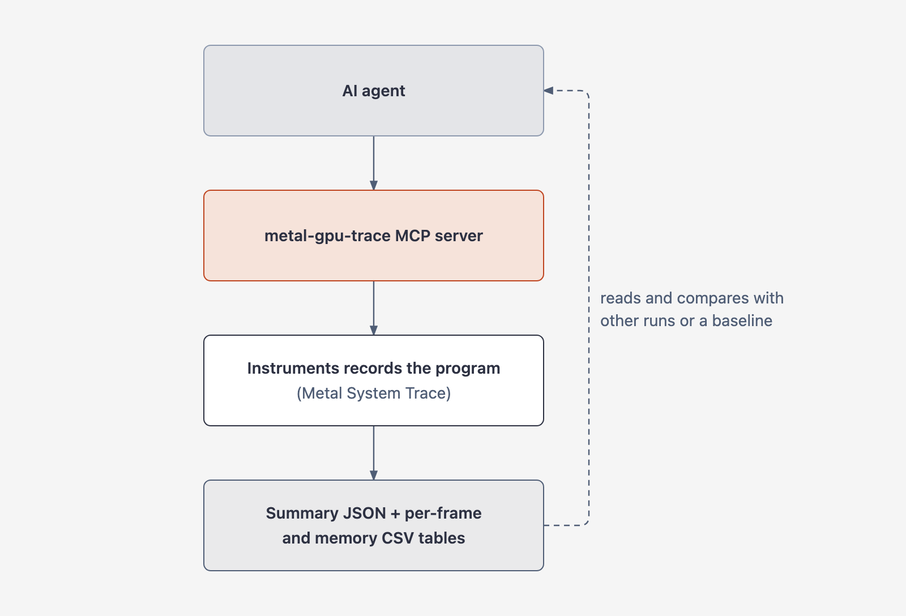

# metal-gpu-trace

[](https://github.com/partprogramming09/metal-gpu-trace/actions/workflows/test.yml)

<!-- mcp-name: io.github.partprogramming09/metal-gpu-trace -->

English · [Español](es/README.md)

## In short

metal-gpu-trace measures how hard a program works the graphics chip (the GPU) of a Mac with Apple silicon, and whether its pictures come out evenly. It is for people who port or test games and apps on a Mac (Windows games under Wine included), and for the AI coding agents that help them.

Real example: a 20-second recording of the `drawstress` test program ran at 104.5 FPS, and the GPU needed 5.6 ms to draw each picture (see [A first result](#a-first-result)).

Ask your agent to record again after a change, and it says with numbers whether the program got faster, slower or stayed the same. It needs Xcode to record, and it does not fix the program.

## How it works

Your AI agent calls the metal-gpu-trace server. The server starts Instruments (Apple's profiler, installed with Xcode), which records the program for the seconds you asked. It writes a summary (a JSON file with the numbers) and two small tables, one row per frame and one for memory. The agent reads them back and compares them with other recordings or with a saved reference.



Details for people who change the code: [How it works](docs/guides/how-it-works.md).

## Start in 4 steps

1. **Install Xcode** from the App Store. Open the Terminal app and type `xcrun xctrace version`: it should print a version.
2. **Install uv**, a tool that downloads and runs the server for you. In the Terminal: `brew install uv` (needs Homebrew, see brew.sh).
3. **Connect the server to your agent.** An MCP server is a small helper program that gives your AI agent new tools. For Claude Code, paste this in the Terminal (`METAL_TRACE_OUT` is the folder where recordings are saved): `claude mcp add --scope user metal-trace -e METAL_TRACE_OUT=$HOME/perf-runs -- uvx metal-gpu-trace`. For other AI apps see [MCP server](#mcp-server).
4. **Ask:** "Record my app for 30 seconds, then tell me its FPS and how long the GPU takes per frame." For a Windows program under Wine (software that runs Windows programs on a Mac), also add `-e METAL_TRACE_WINE=/path/to/wine` to the command of step 3 (see [Install](#install)).

## Words used here

- **frame**: one picture the program draws. A game at 60 FPS draws 60 of them each second.
- **FPS**: frames per second. Higher is smoother, until the screen's refresh rate caps it (vsync).
- **GPU ms per frame**: the milliseconds the graphics chip works on one frame. Lower is better, and unlike FPS the screen does not cap it.
- **1 % low**: the FPS of the slowest 1 % of frames. It shows the stutter an average hides, and needs at least 100 frames.
- **hitch**: a frame that takes far longer than its neighbours; you see it as a stutter.
- **frame pacing**: how evenly frames arrive. Even gaps look smooth, uneven gaps look like stutter.
- **encoder**: a block of GPU commands the program sends. Too many tiny ones waste GPU time.
- **command buffer**: the package of work a program hands the GPU; it holds one or more encoders.
- **translation layer**: software that lets a program written for another graphics API (Direct3D, Vulkan) run on Metal, such as DXMT, Mullion or MoltenVK.
- **Wine**: software that runs Windows programs on a Mac.
- **Metal System Trace**: the Instruments recording template that logs what the GPU does; this tool records with it.
- **.trace**: the file Instruments writes. It is large (tens to hundreds of MB), so it is deleted after the summary unless you set `KEEP_TRACE=1`.
- **.gputrace**: a Metal capture of the draw commands of a few frames; this tool reads it without Xcode.
- **baseline**: a saved reference made of several equal recordings. It shows how much a number moves by itself, so a later run can be judged against it.
- **regression**: a change that makes the program worse than its baseline, for example FPS falling under the baseline's range by more than the margin.

## A first result

A trimmed summary of a real 20-second recording of the `drawstress` test program in native Metal (the file holds many more fields):

```json
{
  "process": {"name": "drawstress", "arguments": "--mtl"},
  "duration_s": 20.78,
  "gpu": {
    "frames": 2034,
    "fps_estimate": 104.5,
    "frame_gpu_ms": {"mean": 5.564, "p95": 6.16},
    "frame_interval_ms": {"p95": 10.017, "max": 22.189}
  },
  "encoders": {"per_frame": {"p50": 2}},
  "gpu_idle": {"idle_share": 0.422}
}
```

Read it like this: 2 034 frames in 20.8 s. `fps_estimate` is 104.5: it comes from the median gap between frames, so it can differ from frames divided by seconds (about 98). The GPU needed 5.6 ms per frame on average, and under 6.2 ms for 95 % of them (`p95`). The longest wait between two frames was 22.2 ms. The program sent 2 encoders per frame (the median, `p50`), and the GPU sat idle 42 % of the time. One recording says little by itself: compare two, and repeat a run before calling a difference real.

## What's new

Version 0.27.3, current. Each item links to the command that was run and its real output.

- ✨ **One summary shape on both platforms.** Every new summary (`schema_version` 3) has a `common` block with frame pacing, memory pressure and graphics API, the same keys on macOS and Windows and a `source` per number; what cannot be measured the same way says `comparable: false` instead of a made-up number. [Proof](docs/evidence/v0.27.3.md#a-summary-has-a-common-block-on-both-platforms)
- 🔍 **What a recording allocated.** `perf_memory_breakdown` splits the Metal allocations by type, what is still live and how many times over the live memory was allocated (5.47 in a real run), from the summary alone. [Proof](docs/evidence/v0.27.3.md#what-a-recording-allocated-by-type)
- 🩺 **An honest verdict against one run.** `perf_check` adds a `note` when the verdict is not same and the reference is a single run: its noise is not measured, so a small change may be noise. [Proof](docs/evidence/v0.27.3.md#perf_check-says-when-its-reference-is-one-run)

Earlier versions (0.27.2, 0.27.0 and older) are in the [changelog](CHANGELOG.md), each with its proof in [docs/evidence/](docs/evidence/). One change to know: a locked screen now refuses a recording (`METAL_TRACE_ALLOW_LOCKED=1` records anyway).

## For developers

Measures how a Wine or macOS program uses the GPU on an Apple silicon Mac, from the command line or through an AI coding agent: GPU time per frame, frame pacing, FPS and memory; whether a translation layer splits the work into too many short encoders; `.gputrace` captures read without Xcode; and Apple's published facts per GPU family. Python 3.9+ standard library, `zsh`, and Xcode (for `xctrace`). MIT license ([LICENSE](LICENSE)). [Español](es/README.md).

Architecture, decisions and guides: [`docs/README.md`](docs/README.md). Sending a change: [`CONTRIBUTING.md`](CONTRIBUTING.md).

| File | What it does |
| --- | --- |
| `src/metal_gpu_trace/perf_record.sh` | Records a program for N seconds and writes `<label>_<date>.json` plus per-frame and memory CSVs. Deletes the `.trace` unless `KEEP_TRACE=1`. |
| `src/metal_gpu_trace/perf_report.py` | Summarizes an existing `.trace` the same way. |
| `src/metal_gpu_trace/gputrace_read.py` | Reads a Metal `.gputrace` without Xcode. Call names marked `probable` are not confirmed. |
| `src/metal_gpu_trace/data/apple-gpu-families.json` | Apple7 to Apple10: chips, what each family adds, limits that differ, with Apple's sources. |
| `src/metal_gpu_trace/metal_trace_mcp.py` | The MCP server over all of the above. |
| `tests/` | Self-check without Instruments: `python3 -I tests/run.py` prints `ok`; `pytest tests` runs the same tests. |

## Recording

```sh
PERF_OUT=~/perf-runs zsh src/metal_gpu_trace/perf_record.sh game-d3d12 30 /path/to/wine ~/.wine /path/to/game game.exe
PERF_OUT=~/perf-runs zsh src/metal_gpu_trace/perf_record.sh app-metal 30 native - /path/to/app ./app
```

Arguments: label, seconds, a Wine directory holding `bin/wine` (or `native`), the Wine prefix, the working directory, the program and its arguments. Without `PERF_OUT`, runs go to `./perf-runs`. Reading the trace takes about a minute on an M1 Pro (87 s for a 10 s recording). Through the MCP server the call times out after 10 s per recorded second plus 120 s, and an overrun recording leaves no files behind. One recording runs at a time; keep other GPU work off the Mac while it records. Under Wine, record for 30 s: Wine's start-up takes part of the recording. Under 100 frames is too short to compare.

## Disk use

Each recording keeps a JSON summary and three CSVs, about 2 MB for 10 s (most of it the Metal memory samples). The `.trace` is deleted unless `KEEP_TRACE=1`. `PERF_MEMORY=0` skips the Metal memory table, the slowest to read (41 % faster to summarize a 626 MB trace); the summary then has no `metal_memory_mib`. The MCP tools `perf_record` and `perf_baseline_record` offer the same as `memory=false`. What each setting deletes: [Retention](docs/guides/data-and-lifecycle/retention.md).

## MCP server

### Install

The server runs with [`uvx`](https://docs.astral.sh/uv/) from [PyPI](https://pypi.org/project/metal-gpu-trace/), with nothing to clone (`brew install uv` installs it). Recording also needs Xcode (`xcrun xctrace version` prints a version).

```sh
uvx metal-gpu-trace
```

This is the command each client below runs. Desktop apps do not see Homebrew's `PATH`: give them the full path that `which uvx` prints (`/opt/homebrew/bin/uvx` on Apple silicon). `uvx` keeps the version it first downloaded; run the command once with `--refresh` to get the latest. `uvx metal-gpu-trace@0.4.0` pins a version.

The server reads these environment variables:

| Variable | What it sets |
| --- | --- |
| `METAL_TRACE_OUT` | Where recordings go. Give an absolute path: the default, `./perf-runs`, depends on the client's working directory. A project file takes precedence. |
| `METAL_TRACE_PROJECT` | The project file to use (or the folder holding it), instead of searching from the working directory. |
| `METAL_TRACE_WINE` | The Wine directory (holding `bin/wine`) that `perf_record` uses when the call names none. |
| `WINEPREFIX` | The Wine prefix used when the call names none; `~/.wine` otherwise. |
| `METAL_TRACE_READ` | More directories the tools may read, separated by `:` (`;` on Windows). |
| `METAL_TRACE_LOG` | `off` silences the one-line stderr log per call. |
| `KEEP_TRACE` | `1` keeps each recording's `.trace`, for `trace_tables`, `trace_query` or Instruments. |
| `METAL_TRACE_ALLOW_LOCKED` | `1` records with the screen locked. Without it a recording is refused: a locked session leaves the frames unpaced. |
| `METAL_TRACE_MAX_DISK_MB` | Size limit of the runs folder, in MiB. After each recording the oldest `.trace` goes first, then `.chrome-trace`, then per-frame and memory tables; summaries and `baselines.json` never. [Retention](docs/guides/data-and-lifecycle/retention.md) |
| `KEEP_RUNS` | Keeps only the newest N recordings. It never removes a `.trace`, and `baselines.json` is never removed. [Retention](docs/guides/data-and-lifecycle/retention.md) |
| `METAL_TRACE_LOCK` | The lock that keeps recordings one at a time, whatever folder each goes to (default `~/Library/Caches/metal-gpu-trace/recording.lock`). [Cache and lock](docs/guides/data-and-lifecycle/cache-and-lock.md) |
| `PERF_ENV` | `NAME=VALUE` pairs, separated by spaces, set for the recorded program. |
| `PERF_INSTRUMENTS` | Instruments added to the Metal System Trace template, separated by `;` (`xcrun xctrace list instruments` names them). Their tables need the `.trace`: pair it with `KEEP_TRACE=1`. |

### Projects

A repository can hold a `metal-gpu-trace.json` that names its project and the folder of its recordings:

```json
{"name": "my-game", "runs": "perf-runs", "baseline": "main-ref"}
```

The server looks for it in its working directory and the folders above it, stopping below the home folder, so one file at a repository's root serves every folder inside it. When it finds one, recordings go to and are read from `runs` instead of `METAL_TRACE_OUT`, and `baselines.json` lives there too: projects do not mix their recordings. [Project file](docs/guides/data-and-lifecycle/project-and-config.md)

| Key | Meaning |
| --- | --- |
| `name` | The project's name (letters, digits, `.`, `_`, `-`). Required. |
| `runs` | The recordings folder. Required. It must be new, empty or already marked by the server (a plain `.metal-gpu-trace-runs` file, not a folder or a link). A folder with other files is refused, because `KEEP_RUNS` removes old `.json` files there. A folder marked with another project's name is refused; to hand it over, edit or remove the mark. |
| `baseline` | The name of the project's reference (`perf_baseline`). `project_info` reports it. |
| `format` | `metal-gpu-trace`, the only one for now. |

Any other key, or a wrong value, is an error that every tool reports, naming the field, until the file is fixed. Without a project file, `METAL_TRACE_OUT`, or `./perf-runs`, is used as before.

### Claude Code

```sh
claude mcp add --scope user metal-trace -e METAL_TRACE_OUT=$HOME/perf-runs -e METAL_TRACE_WINE=/path/to/wine \
  -- uvx metal-gpu-trace
claude mcp list
```

`claude mcp list` shows `metal-trace` as connected. `--scope user` makes it available in every project; leave it out to add it to the current project only.

### Windows

On Windows the server records native programs (`src/metal_gpu_trace/perf_record_windows.py`): no Wine, no Metal, and `METAL_TRACE_WINE` is not needed. Frames come from Intel's [PresentMon](https://github.com/GameTechDev/PresentMon) (MIT), installed with `presentmon_install`, found on `PATH`, or pointed to with `PRESENTMON_EXE`. Without it the summary falls back to DWM composition intervals (`gpu.source` is `dwm-composition`), which cover the whole desktop and carry no GPU time. With neither source a recording fails; it never invents frames. Details: [Windows engine](docs/guides/recording/windows-engine.md).

```powershell
winget install --id=astral-sh.uv -e
claude mcp add --scope user metal-trace -e METAL_TRACE_OUT=%USERPROFILE%\perf-runs -- uvx metal-gpu-trace
claude mcp list
```

In JSON clients use `"command": "uvx"` (or the full path `where uvx` prints) and Windows paths with doubled backslashes. Claude Desktop reads `%APPDATA%\Claude\claude_desktop_config.json`. Run the Windows tests with `python -m pytest tests/test_perf_record_windows.py`.

### Claude Desktop, Cursor and other JSON clients

These apps do not expand `~` or `$HOME`: write absolute paths.

```json
{
  "mcpServers": {
    "metal-trace": {
      "command": "/opt/homebrew/bin/uvx",
      "args": ["metal-gpu-trace"],
      "env": {
        "METAL_TRACE_OUT": "/absolute/path/to/perf-runs",
        "METAL_TRACE_WINE": "/absolute/path/to/wine"
      }
    }
  }
}
```

| Client | File |
| --- | --- |
| Claude Desktop | `~/Library/Application Support/Claude/claude_desktop_config.json` (Settings, Developer, Edit Config); restart the app |
| Cursor | `~/.cursor/mcp.json` |
| VS Code | `.vscode/mcp.json` in the project; the top key is `servers`, and the server adds `"type": "stdio"` |
| Codex CLI | `~/.codex/config.toml`: a `[mcp_servers.metal-trace]` table with the same `command`, `args` and `env` |

### Tools

26 tools in four groups. Your agent picks them; you rarely call one yourself. Each tool's arguments are in [Server and transport](docs/guides/server-and-transport/registry.md).

| Group | Tools (what each is for) |
| --- | --- |
| Record | `perf_record` (one run and its summary), `perf_attach` (a program already running), `perf_baseline_record` (several runs saved as a reference), `perf_ab` (two environments, which is better), `perf_sweep` (one run per value of a setting), `perf_cold_warm` (first start-up against the second, shader-compile hitches) |
| Judge and compare | `perf_compare` (two recordings, what got faster or slower), `perf_check` (same, better or regressed against a reference), `perf_gate` (pass or fail against your limits), `perf_baseline` (saves equal runs and shows their spread), `perf_history` (one number across many runs), `perf_diagnose` (too many tiny GPU pieces, as translation layers cause), `perf_memory_breakdown` (Metal allocations by type) |
| Dig deeper | `perf_export_trace` (frames for Perfetto or Chrome), `trace_tables`, `trace_count`, `trace_query` (tables of a kept `.trace`), `capture_summary`, `capture_diff`, `capture_records` (`.gputrace` captures) |
| Setup and test programs | `project_info` (active project), `perf_runs` (recordings, newest first), `gpu_family` (Apple's facts per chip), `workload_list`, `workload_fetch` (test programs, checked by SHA-256; Claude Code asks first), `presentmon_install` (Windows only) |

The test programs, their arguments (`workload`, `api`, `dim`, `size`, `example`) and the Mac levers are in [Test programs](docs/guides/recording/test-programs.md). Reading numbers across runs: [Reading and comparing](docs/guides/summarizing/reading-and-comparing.md).

## HTTP

`METAL_TRACE_TOKEN=<secret of 16+ characters> metal-gpu-trace --http [--port N]` serves the same tools at `POST http://127.0.0.1:8765/mcp`, for a client on the same Mac that cannot start a stdio server. It listens on 127.0.0.1 only, needs `Authorization: Bearer <token>` on every request, and does not start without the token. It speaks both MCP eras: [HTTP](docs/guides/server-and-transport/http.md), and why two: [ADR-0002](docs/adr/0002-dual-era-mcp.md).

## CI gate

`metal-gpu-trace check RUN BASELINE [--margin-pct N]` runs `perf_check` without a client and prints one JSON line. Exit code 0: same or improved; 1: regressed; 2: could not be judged (no such run or reference, or under 100 frames). Recording needs Instruments, so the job runs on a self-hosted macOS runner:

```yaml
jobs:
  perf:
    runs-on: [self-hosted, macOS, ARM64]
    steps:
      - run: PERF_OUT=~/perf-runs zsh path/to/metal-gpu-trace/src/metal_gpu_trace/perf_record.sh pr 30 native - . ./app
      - run: METAL_TRACE_OUT=~/perf-runs metal-gpu-trace check "$(ls -t ~/perf-runs/pr_*.json | head -1 | xargs basename -s .json)" main-ref
```

## If you want to understand...

- ...how the code is layered and one request end to end: [How it works](docs/guides/how-it-works.md).
- ...how to run or test it from a clone, without PyPI: [Run from a clone](docs/guides/run-from-a-clone.md).
- ...what a recording leaves on disk and what deletes what: [Data and its lifecycle](docs/guides/data-and-lifecycle/index.md).
- ...why a recording is refused, or why it failed: [Preflight](docs/guides/recording/preflight.md), [Failures](docs/guides/recording/failures.md).
- ...how FPS, 1 % low, stutter and hitches are computed: [How the numbers are computed](docs/guides/summarizing/how-numbers-are-computed.md).
- ...why two runs say same, better or worse: [Noise and verdicts](docs/guides/summarizing/noise-and-verdicts.md).
- ...how a `.trace` or a `.gputrace` is read: [Reading traces](docs/guides/reading-traces/index.md).
- ...HTTP, the two MCP eras and the tool registry: [Server and transport](docs/guides/server-and-transport/index.md).
- ...the Windows recording path: [Windows engine](docs/guides/recording/windows-engine.md).
- ...why each decision was made: [`docs/README.md`](docs/README.md) (the ADR index).
- ...the proof behind each release: [docs/evidence/](docs/evidence/).

## Credits

- The record layout of a `.gputrace` command stream follows [tmc/gputrace](https://github.com/tmc/gputrace) (MIT); no code is copied. The call ids were matched against Xcode's command list on macOS 27.0.1.
- GPU family facts: Apple's documents, restated, not quoted.
