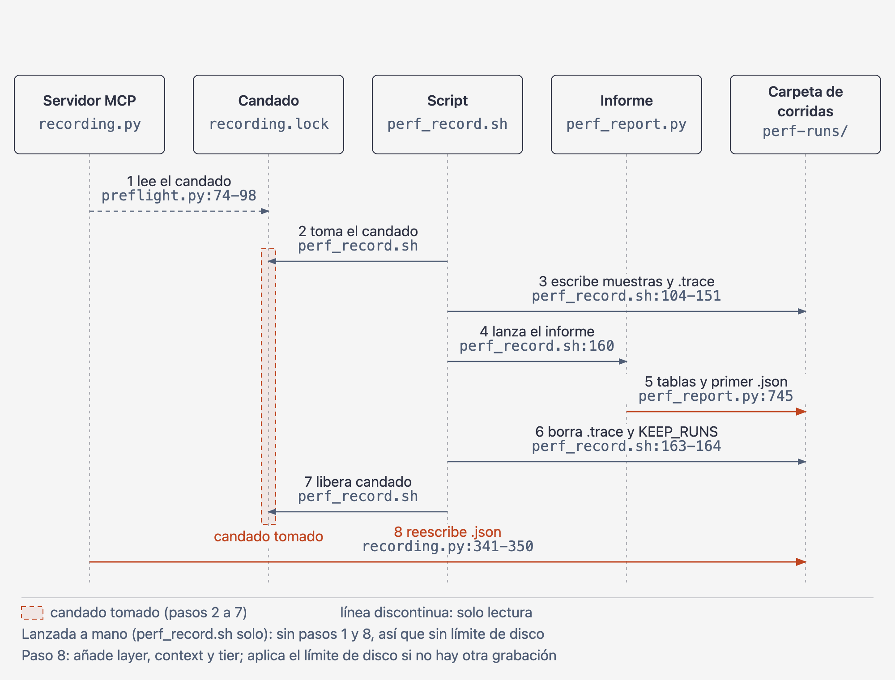

# De una grabación a disco

**Lector:** personas que cambian el orden en que una grabación escribe, toma el candado y limpia. Revisado el 2026-11-16.

English: [From a recording to disk](../../../guides/data-and-lifecycle/recording-to-disk.md)

> **En corto:** una grabación pasa por ocho pasos: comprobar el candado, tomarlo, escribir los datos, construir los
> números, limpiar, soltar el candado y dejar que el servidor termine. El resumen se escribe dos veces. Una grabación lanzada a mano se salta el último paso, así que no tiene límite de tamaño.

Volver al [índice](./index.md). Ejemplo: en una grabación de 20 s, los pasos 3 y 4 hacen aparecer el `.trace` y el `.rss.csv`; el paso 6 hace desaparecer el `.trace`.

*Figura 2. Una grabación en macOS desde la primera comprobación hasta los archivos en disco. Fuente HTML: `docs/es/guides/datos-y-su-ciclo-de-vida/img/data-recording-to-disk.html`.*

Los números son los de la figura; la prueba en [E11](./evidencia-cache-y-flujo.md#e11-los-ocho-pasos-de-la-figura-2).

| # | Paso | Detalle |
|---|---|---|
| 1 | **El servidor comprueba el candado** | `recording.record` llama a `preflight.check` (`recording.py:315`): rechaza si un proceso vivo es su dueño; nunca lo toma |
| 2 | **El script toma el candado** | Escribe su pid; la carpeta pasa a ser de esta grabación |
| 3 | **Muestreadores e Instruments escriben** | Dos bucles de fondo escriben `.rss.csv` y `.agx.csv` una vez por segundo mientras `xctrace` escribe el `.trace` |
| 4 | **El script lanza el informe** | `python3 -I perf_report.py <trace> --label <stem> --out <folder>` |
| 5 | **El informe escribe las tablas y luego un primer resumen** | Tabla de memoria (`perf_report.py:745`), de fotogramas (`:831`), luego el `.json` (`:836`) |
| 6 | **El script borra el `.trace`** | Salvo con `KEEP_TRACE=1`; luego aplica `KEEP_RUNS` si está fijado |
| 7 | **El script suelta el candado** | Al salir |
| 8 | **El servidor termina** | `recording.finish` añade `layer`, `context`, `tier`, aplica el límite de disco si no corre otra grabación y **reescribe** el `.json` |

## Consecuencias que conviene saber

- **El resumen se escribe dos veces** (pasos 5 y 8), así que un rato la primera versión no tiene `layer` ni `context`. Ambas escrituras son `write_text` simple (`perf_report.py:836`, `recording.py:350`), no el nombre temporal y renombrado de las tablas, así que un lector podría en principio coger un archivo a medio escribir. `perf_runs` omite un resumen que no se puede leer (`analysis.py:80-81`: «a summary still being written»). Confirmado por el código; una lectura a medias **no se reprodujo** (límite conocido 9).
- **El límite de disco solo existe en la ruta del servidor.** Un `perf_record.sh` lanzado a mano acaba en el paso 7: tiene `KEEP_RUNS` y `KEEP_TRACE` pero no `METAL_TRACE_MAX_DISK_MB`, que se aplica en Python (`recording.py:346`) (confirmado).
- **`KEEP_RUNS` corre con el candado tomado** (paso 6 antes del 7), así que ninguna otra grabación empieza a mitad del borrado.
