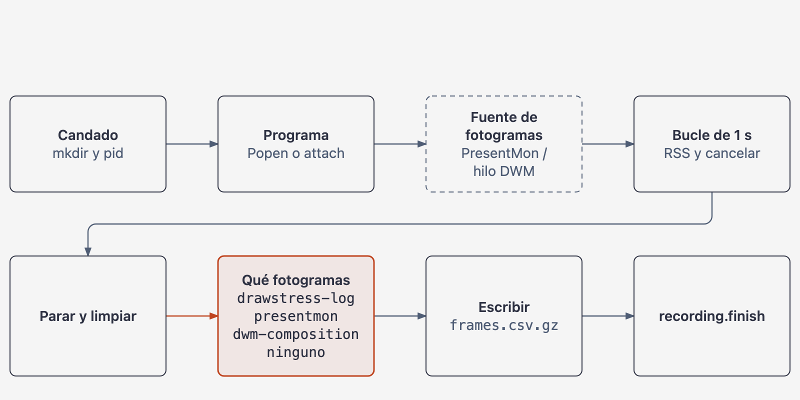

# El motor de Windows

**Lector:** personas que cambian `perf_record_windows.py` o que necesitan saber por qué una grabación de Windows no tiene tiempos de GPU por encoder. Revisado el 2026-11-16. Etiquetas: véase [Grabar](./index.md#como-leer-las-etiquetas).

English: [The Windows engine](../../../guides/recording/windows-engine.md)

**En corto:** Windows no tiene Instruments, así que un motor aparte graba un programa de Windows midiendo cuándo se mostró
cada fotograma en pantalla. Elige la mejor de tres fuentes de datos de fotogramas y escribe el mismo tipo de resumen que
macOS, con algunos bloques vacíos. Ejemplo: con un juego y PresentMon instalado, el motor arranca el juego y PresentMon,
espera los segundos pedidos y convierte las filas de PresentMon en el resumen.

`perf_record_windows.py` es toda la grabación de Windows. El servidor lo llama desde `record_run` cuando
`sys.platform == "win32"` (`recording.py:373-385`), con una importación tardía porque el módulo puede haberse importado ya
por otra cosa (`:374`), y `record_run` termina luego en el mismo `finish` que macOS (`:385`). También se puede lanzar a
mano: `python src\metal_gpu_trace\perf_record_windows.py <label> <seconds> <wine|native|attach> <prefix> <workdir>
<command...>` (`main`, `:950-962`; correrlo en el Mac sin argumentos imprime la línea de uso, lo que **no se reprodujo**
aquí).

*Figura 1. Una grabación de Windows. Fuente HTML: `img/motor-windows.html`.*

## Por qué un motor aparte, y qué mide

Instruments existe solo en macOS, así que el motor de Windows no puede producir un `.trace`: no hay `xctrace`, ni Metal
System Trace, ni tiempos por encoder. Lo que puede medir es **cuándo se presentaron los fotogramas**. Construye la misma
forma de resumen con `metrics.py` (`:24-28`, `:887-917`), pero varios bloques quedan vacíos o fijos: `missing_tables`
lista por nombre tres tablas de Metal, `metal_memory_mib` es `{"samples": 0}`, y `encoders` y `gpu_idle` se calculan con
los tramos de la única fuente que los tenga ([E8](./evidencia.md)). Las claves del resumen están en la
[guía de datos](../datos-y-su-ciclo-de-vida/claves-del-resumen.md#un-resumen-de-windows).

## Las tres fuentes de fotogramas, y cuál gana

| Orden | Fuente | `gpu.source` | Qué da | Qué no puede dar |
|---|---|---|---|---|
| 1 | El registro del propio programa: `DRAWSTRESS_LOG`, una línea por lote de fotogramas (`dim`, `draws`, `frame_us`, `frames`) | `drawstress-log` | Tiempo de GPU por fotograma (una media por línea) y tramos para las estadísticas de encoders | Una distribución por fotograma: 1% low, 0,1% low, tasa de stutter y jitter quedan en `null` (`:859-862`), porque cada línea ya es una media |
| 2 | Filas de PresentMon: `MsBetweenPresents` y, cuando la columna existe y es positiva, `MsGPUTime` | `presentmon` | Una fila por `Present()` de ese proceso, con su tiempo de GPU | Tiempos por encoder |
| 3 | Un hilo de 1 ms que lee el compositor (`DwmGetCompositionTimingInfo`) | `dwm-composition` | Intervalos entre fotogramas compuestos de **todo el escritorio** | Tiempo de GPU por fotograma, y nada específico del proceso |
| ninguna | | | | La corrida falla: `no frame data` |

El orden es el de la cadena de `if` (`:787`, `:808`, `:819`, `:830`), así que una **corrida de drawstress en una máquina
con PresentMon instalado igualmente corre PresentMon** (arranca en `:652-659`, antes de leer el registro del programa)
**pero sus filas no se usan**: gana el registro. Esto está confirmado por el código; no se reprodujo.

Por qué tres fuentes: el registro es exacto para el programa de prueba del propio proyecto, PresentMon es la herramienta
adecuada para cualquier otro programa, y el compositor es un último recurso que funciona sin ninguna herramienta
instalada. El muestreador del compositor solo cuenta un intervalo entre dos fotogramas compuestos consecutivos: un salto
de varios fotogramas se descarta en lugar de repartirse en partes iguales (`:403-407`), así que nunca inventa
fotogramas.

## Paso a paso (Figura 1)

| # | Etapa | Qué pasa | Línea |
|---|---|---|---|
| 1 | **Candado** | El servidor pasa `config.LOCK`, la misma carpeta que usa macOS; lanzado a mano, el motor usa `<corridas>/.recording` (`:574`). `mkdir`, escribe el pid; si ya existe y su dueño está muerto, lo quita e intenta una vez más (dos intentos), y si no `another recording is running (<candado>); remove it if none is` ([E9](./evidencia.md)) | `:573-597` |
| 2 | **Programa** | Con `attach`, `find_attached_process` encuentra el pid por número o por un nombre dentro del nombre del proceso (gana el pid más alto, `:457-483`). Si no, mezcla `program_env` y `PERF_ENV` en el entorno, pone `DRAWSTRESS_LOG` en `<corridas>/<nombre>.drawstress.log` y arranca el programa con `Popen` | `:612-645` |
| 3 | **Fuente de fotogramas** | Si `find_presentmon` encontró uno, lo arranca con `--process_id`, `--timed <segundos>`, `--terminate_after_timed`, `--stop_existing_session`; si no, arranca el hilo de DWM | `:647-666` |
| 4 | **El bucle** | Una vez por segundo: toma una muestra del working set (`rss.csv`), mira el plazo y la señal de cancelar, y se detiene antes si el programa terminó solo. El progreso sale cada 5 s | `:673-705` |
| 5 | **Detener** | Detiene el hilo de DWM; espera hasta 15 s a PresentMon y lo mata si no se detiene; al cancelar o pasarse del plazo, mata el árbol del programa, borra todo archivo que empiece por el nombre de la corrida y lanza `the recording was cancelled; nothing was saved` o `the recording took over N s and was stopped; nothing was saved` (`:744-746`). Si la grabación terminó y el programa sigue vivo, lo termina, y luego mata su árbol | `:707-757` |
| 6 | **Qué fotogramas** | La tabla de arriba | `:759-844` |
| 7 | **Escribir** | La tabla `frames.csv.gz`, las estadísticas (los números de ritmo salen de `perf_report.frame_pacing`, la misma función que usa macOS, `:489`), el resumen, el bloque `common`, el `.json`, y `KEEP_RUNS` con su propio `clean_runs` (`:503-518`, `:921-924`) | `:846-927` |
| 8 | **Terminar** | De vuelta en `record_run`, `finish` añade `layer`, `context`, `tier` y el límite de disco | `recording.py:385` |

Un `finally` corre siempre que la grabación no tuvo éxito: detiene el hilo de DWM y PresentMon, mata el programa que
arrancó (nunca uno al que se enganchó) y borra todo archivo que empiece por el nombre de la corrida, y luego suelta el
candado (`:929-947`). El candado también se suelta si hubo éxito.

## Qué cambia respecto de macOS

| | macOS | Windows |
|---|---|---|
| Grabador | `perf_record.sh` manejando `xctrace` | `perf_record_windows.py`, en el propio proceso del servidor |
| Tiers | `light`, `standard`, `deep` | `deep` rechazado (`recording.py:49-50`); `memory` no tiene efecto: no hay tabla de memoria Metal |
| `memory_free_pct`, `background` | permitidos | rechazados (`recording.py:283-284`) |
| Disco necesario | `2 + 0,8 GB` por segundo, en `TMPDIR` y en la carpeta de corridas | 1 GB, en la carpeta de corridas (`preflight.py:50`, `:123-124`) |
| `xcrun`, pantalla | se comprueban | no se comprueban (`preflight.py:120`, `:132`) |
| Detener el programa al final | por nombre (`native`) o `wineserver -k` | el árbol de procesos (`kill_process_tree`, `:521-551`) |
| Wine | sí | no: `wine` pasa a ser `native` cuando no se da ninguno (`recording.py:61-65`), y un api marcado `wine: true` corre nativo (`workloads.py:88-89`) |
| Vida del candado | `mkdir` + tomar uno muerto bajo un segundo candado | `mkdir` + tomar uno muerto una vez, sin segundo candado ([límite 3](./limites.md)) |
| Tabla de fotogramas | `frames.csv.gz` con un `gpu_ms_<canal>` por canal | `frames.csv.gz` con `gpu_ms_draw` y `gpu_ms_total` (`:847`) |

## Datos de hardware para el bloque `device`

`perf_record_windows.py` también lee datos de hardware para el bloque `device`: Win32 para el procesador, la RAM y la
versión del sistema, y, cuando se encuentra un `vegaflow_daemon.exe` junto al clon, una llamada `--system-info` con plazo
de 1 s que añade nombres de arquitectura de CPU y GPU (`collect_device_info`, `:242-283`; `daemon_candidates`
`:231-239`). Cualquier fallo vuelve a los datos de Win32 en silencio. Qué es VegaFlow, de dónde viene y quién lo ejecuta
**no está documentado en las guías de este repositorio** y no se investigó: pendiente de confirmar
([límite 14](./limites.md)).
