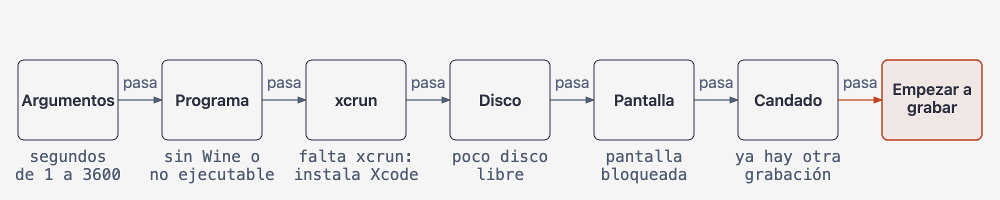

# Preflight

**Lector:** personas que añaden o cambian un rechazo en `preflight.py` o en `perf_record.sh`. Revisado el 2026-11-16. Etiquetas: véase [Grabar](./index.md#como-leer-las-etiquetas).

English: [Preflight](../../../guides/recording/preflight.md)

**En corto:** antes de que arranque nada, el servidor comprueba en milisegundos que la grabación puede funcionar: números
válidos, que existan el programa y Wine, que estén instaladas las herramientas de Xcode, que haya disco suficiente, que
la pantalla esté desbloqueada y que nadie más esté grabando. La primera comprobación que falla detiene la llamada con una
frase que dice qué hacer. No se arrancó nada, así que no hay nada que limpiar. Ejemplo: `seconds=5000` termina al
instante con `seconds is a whole number from 1 to 3600`.

`preflight.check` (`preflight.py:101-137`) corre seis comprobaciones en orden fijo y lanza un `ToolError` en la primera
que falla ([E1](./evidencia.md)). Todas son de milisegundos y ninguna arranca un proceso, salvo leer el estado de la
pantalla (`ioreg`, plazo de 10 s, `perf_report.py:593-604`).

*Figura 1. Las comprobaciones de `preflight.check` y el mensaje de cada una. Fuente HTML: `img/comprobaciones-preflight.html`.*

| # | Qué comprueba | Mensaje cuando falla | Línea | Prueba (no ejecutada aquí) |
|---|---|---|---|---|
| 1 | `seconds` es un entero de 1 a 3600 (`whole_seconds` rechaza `10.5`, `True` y `"1_0"`, formas que Python acepta y el shell no) | `seconds is a whole number from 1 to 3600` | `preflight.py:107-108`, `:30-41` | `test_seconds_are_checked_before_anything_else` `:357` |
| 1 | `environ` es un mapa de texto; `wine` es una ruta o `native` o `attach`; `command` es una lista de textos | `environ is a mapping of text`, `wine is a path or native or attach, and the command a list of strings` | `:109-114` | |
| 2 | Un directorio de Wine tiene un `bin/wine` ejecutable | `no Wine at bin/wine inside that Wine directory (pass native for a macOS program)` | `:115-116` | `test_missing_wine_binary` `:65` |
| 2 | Con `native`: el programa es un archivo con el bit de ejecución | `<nombre> is not an executable file` (solo el nombre del archivo) | `:117-119` | `test_native_program_not_executable` `:72` |
| 3 | `xcrun` está en el `PATH` del entorno de la petición (no en Windows) | `xcrun is not on PATH: install Xcode or the command line tools (xcode-select --install)` | `:120-121` | `test_no_xcrun` `:81` |
| 4 | GB libres en la carpeta temporal y en la de corridas, cada una al menos lo necesario | `not enough free disk on the temporary folder (TMPDIR): N GB free, M GB needed (PERF_MIN_FREE_GB overrides)` (o `the runs folder`) | `:122-131` | `test_not_enough_disk_names_the_override` `:89` |
| 4 | Se puede leer el espacio libre (una ruta con byte nulo, un `disk_usage` que falla) | `the free disk space cannot be read for the runs or the temporary folder` | `:61-71` | |
| 5 | La pantalla de la sesión no está bloqueada (`ioreg`); no en Windows; `METAL_TRACE_ALLOW_LOCKED=1` la salta; un estado ilegible pasa | `the screen is locked: a locked session leaves the program's frames unpaced by the display, so the numbers do not compare; unlock the Mac, or set METAL_TRACE_ALLOW_LOCKED=1 to record anyway` | `:132-134` | `test_locked_screen_refuses_and_names_the_override` `:118` |
| 6 | La carpeta-candado no nombra un proceso vivo | `another recording is running; one runs at a time. If none is, remove the lock folder (METAL_TRACE_LOCK names it)` | `:135-137` | `test_live_lock_refuses` `:152` |

## Cómo salen los números de la comprobación 4

- Lo necesario es `PERF_MIN_FREE_GB` cuando es un número simple, y si no `2 + (seconds × 8 + 9) / 10` en división
  entera (`preflight.py:44-50`), que da 18 GB para 20 s, 26 para 30 s y 50 para 60 s ([E3](./evidencia.md)). En
  Windows es 1 GB, porque no hay Instruments (`:50`). El script de shell calcula la misma fórmula
  (`perf_record.sh:34`); `test_disk_formula_matches_the_shell` (`tests/test_preflight.py:101`) fija que las dos
  coinciden.
- La carpeta temporal es `TMPDIR` del entorno de la petición, o `/tmp` (`:126`): ahí escribe `xctrace` sus archivos
  `.ktrace` mientras graba.
- Una carpeta de corridas que aún no existe se mide en su padre existente más cercano (`free_gb`, `:61-71`).

## La comprobación del candado

`lock_owner_alive` (`:74-93`) está hecha para una carpeta en la que cualquiera puede escribir. La razón es dónde está el
candado: un archivo `pid` hostil o roto no debe colgar una grabación, señalar un grupo entero de procesos ni romper la
comprobación.

| Hace | Contra |
|---|---|
| Se niega a seguir un enlace | (la página no da una razón aparte) |
| Lee como mucho 32 bytes con una apertura que no bloquea | un cuelgue (una tubería) |
| Acepta solo dígitos ASCII de hasta 10 caracteres y un pid de 1 a 2³¹−1 | señalar un grupo entero de procesos (pid 0 o −1, `:16`) |
| Trata cualquier cosa rara como «no hay dueño vivo» | que la comprobación se rompa |

En Windows nunca se usa `os.kill`, porque allí termina el proceso; `perf_record_windows.is_process_alive` pregunta con
`OpenProcess` (`:18-20`). `test_hostile_pid_files_are_not_a_live_owner` (`tests/test_preflight.py:336`) fija los casos
raros.

## Qué no comprueba preflight

| No se comprueba | Quién lo atrapa, y cómo | Línea |
|---|---|---|
| Que exista un proceso al que engancharse (`perf_attach` pasa preflight con cualquier texto) | El script: `no running process matches <nombre>` (salida 2). El motor de Windows: lo mismo como `RuntimeError`. Llega como `recording failed ...` o como un `ToolError` simple | `perf_record.sh:24`; `perf_record_windows.py:475`, `:480` |
| El prefijo de Wine, el directorio de trabajo, el `api` frente a la plataforma | Se usan después, por el script o por `Popen` | |
| Que el programa sea un Mach-O | El script compara los cuatro primeros bytes con una lista de números mágicos de Mach-O (y ELF y `#!`, «para el CI de Linux») y rechaza con `<nombre> is not a program the system can run (no Mach-O or #! header)` | `perf_record.sh:14-19` |
| La etiqueta | `record` la comprueba antes de preflight, y el script la vuelve a comprobar | `recording.py:312`; `perf_record.sh:10` |

## Qué repite cada capa

| Comprobación | `recording.py` / `preflight.py` | `perf_record.sh` |
|---|---|---|
| Etiqueta | `recording.py:312` | `:10` (salida 2) |
| Segundos de 1 a 3600 | `preflight.py:107` | `:11` (salida 2) |
| Directorio de Wine | `preflight.py:115` | `:12` (salida 2) |
| Programa nativo | `preflight.py:117` | `:13`, `:14-19` (salida 2) |
| `xcrun` | `preflight.py:120` | ninguna: simplemente se llama a `xcrun` |
| Disco | `preflight.py:122-131` | `:34-38` (salida 4, el mensaje lleva la carpeta) |
| Pantalla bloqueada | `preflight.py:132` | ninguna |
| Candado | `preflight.py:135` | `:47-61` (salida 3) |
| Proceso al que engancharse | ninguna | `:20-25` (salida 2) |

Los códigos de salida y los mensajes del script están en [E2](./evidencia.md).
