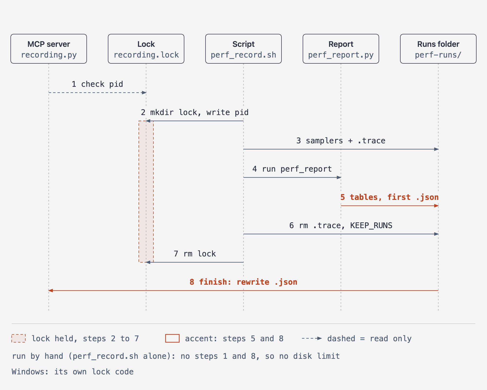

# From a recording to disk

**Reader:** people who change the order in which a recording writes, locks and cleans up. Reviewed 2026-11-16.

Español: [De una grabación a disco](../../es/guides/datos-y-su-ciclo-de-vida/de-grabacion-a-disco.md)

> **In short:** a recording goes through eight steps: check the lock, take it, write the data, build the numbers, clean
> up, free the lock, and let the server finish the numbers. The summary file is written twice, once by the report and
> once by the server. A recording started by hand skips the last step, so it has no size limit.

Back to the [index](./index.md). Example: for a 20 s recording, steps 3 and 4 are what makes the `.trace` and
the `.rss.csv` appear, and step 6 is what makes the `.trace` disappear again.

*Figure 2. A macOS recording from the first check to the files on disk. HTML source: `docs/guides/data-and-lifecycle/img/data-recording-to-disk.html`.*

The numbers are those of the figure; the proof of each is in [E11](./evidence-cache-and-flow.md#e11-the-eight-steps-of-figure-2).

| # | Step | Detail |
|---|---|---|
| 1 | **The server checks the lock** | `recording.record` calls `preflight.check` (`recording.py:315`), which reads the lock and refuses if a live process owns it. It never takes it |
| 2 | **The script takes the lock** | Writes its pid. From here the folder belongs to this recording |
| 3 | **The samplers and Instruments write** | Two background loops write `.rss.csv` and `.agx.csv` once a second while `xctrace` writes the `.trace` |
| 4 | **The script starts the report** | `python3 -I perf_report.py <trace> --label <stem> --out <folder>` |
| 5 | **The report writes the tables and a first summary**, in that order | The memory table (`perf_report.py:745`), the frames table (`:831`), then the `.json` (`:836`) |
| 6 | **The script deletes the `.trace`** | Unless `KEEP_TRACE=1`; then applies `KEEP_RUNS` if it is set |
| 7 | **The script frees the lock** | When it exits |
| 8 | **The server finishes** | `recording.finish` adds `layer`, `context`, `tier`, applies the disk limit if no other recording is running, and **rewrites** the `.json` |

## Consequences worth knowing

- **The summary is written twice** (steps 5 and 8), so for a short time the first version has no `layer` or `context`.
  Both writes are plain `write_text` (`perf_report.py:836`, `recording.py:350`), not the temporary-name-and-rename
  that tables use, so a reader can in principle catch a half-written file. `perf_runs` skips a summary that does not
  parse (`analysis.py:80-81`; its comment reads "a summary still being written"). Confirmed by the code; a
  half-read was **not reproduced** (known limit 9).
- **The disk limit only exists on the server's path.** A recording started by hand with `perf_record.sh` stops at step 7:
  it has `KEEP_RUNS` and `KEEP_TRACE`, but no `METAL_TRACE_MAX_DISK_MB`, because that is applied in Python
  (`recording.py:346`) (confirmed).
- **`KEEP_RUNS` runs while the lock is still held** (step 6 is before step 7), so no other recording can start between
  the deletion and the end of this one.
