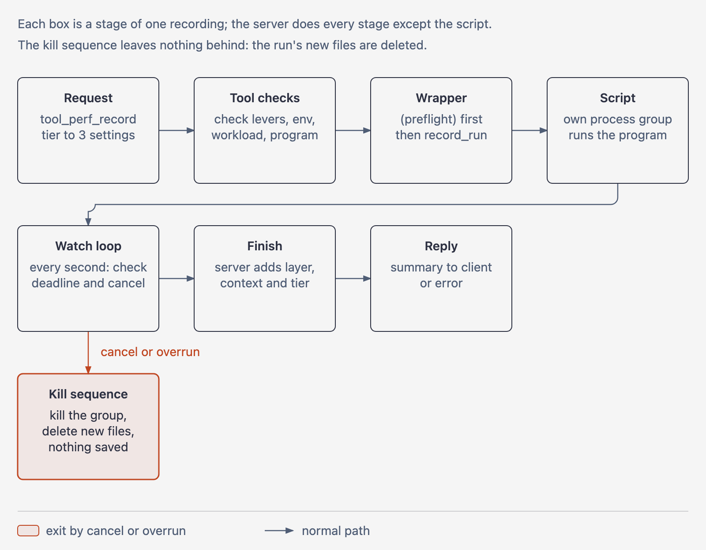

# The macOS journey

**Reader:** people who change `recording.py` or `perf_record.sh`. Reviewed 2026-11-18. Labels: see [Recording](./index.md#how-to-read-the-labels).

**In short:** a recording request goes through five stages: it becomes a command, a wrapper checks and prepares the Mac,
a script is started with a clean environment, the server watches it once a second, and when the script returns the
server completes the summary. Cancelling or running past the deadline follows a fixed kill sequence that deletes
everything the run created. Every run also records which translation layer it ran on and where the code came from.

Everything below is **confirmed** by the lines named. The files it leaves are in the
[data guide](../data-and-lifecycle/files-on-disk.md#what-a-recording-leaves-on-disk).


*Figure 1. One macOS recording and the exit by cancel or overrun. HTML source: `img/macos-journey.html`.*

## Step 1: the request becomes a command

`tool_perf_record`, `recording.py::tool_perf_record`.

1. `resolve_tier` turns `tier` into three settings (`recording.py::resolve_tier`):

   | Tier | Metal memory | GPU counters | `.trace` kept | What it costs |
   |---|---|---|---|---|
   | `light` | no | no | no | seconds of read-back: to iterate |
   | `standard` (default) | yes | no | no | the memory table is the slowest to read |
   | `deep` | yes | yes | yes (unless the disk limit drops it) | counters add about 40 s of read-back per recorded second (`recording.py::tool_perf_record`) |

   A `memory` or `counters` passed on its own replaces that part of the tier. `deep` is refused on Windows (`recording.py::tool_perf_record`).
2. `check_levers` refuses a `memory_free_pct` outside 20 to 60 and either lever on Windows (`recording.py:274-284`).
3. `check_env` accepts only space-separated `NAME=VALUE` pairs (`recording.py::check_env`): the script splits on spaces.
4. With `workload`, `workloads.workload_command` supplies the program, Wine mode, arguments and environment
   (`recording.py::tool_perf_record`; [The test programs](./test-programs.md)). `size` without a workload is refused (`:57-58`); no `program` is refused (`:59-60`).
5. Without `wine`, `METAL_TRACE_WINE` is used; on macOS with neither, the call is refused (`:61-65`). The program must
   exist (`:66-68`); the error names the file, not the path.
6. `perf_attach` skips most of that: `record(label, seconds, "attach", "-", "-", [process])` (`recording.py:95`). It
   has no tier, so the summary has no `tier` key (`recording.py:344-345`), and the program keeps running afterwards.

## Step 2: the wrapper

`record`, `recording.py:309-322`. In this order:

| # | What | Line |
|---|---|---|
| 1 | The label: letters, digits, `.`, `_`, `-`, at most 100 | `:312` |
| 2 | The levers | `:314` |
| 3 | **Preflight** ([Preflight](./preflight.md)) | `:315` |
| 4 | `memory_pressure` if `memory_free_pct` was given: waits up to 90 s for "Stable at percent free" and refuses if it never comes (`hold_memory_pressure`) | `:316`, `:287-306` |
| 5 | `record_run`. A `finally` stops the pressure whatever happens | `:319-322` |

Preflight goes before the pressure on purpose: a refused run must start nothing. `test_record_runs_preflight_before_memory_pressure`
and `test_preflight_failure_starts_no_process` (`tests/test_preflight.py:275`, `:296`) pin that (not run for this guide).

## Step 3: the environment the script gets

`record_run` builds it at `recording.py:360-370` ([E6](./evidence.md)).

| Variable | Set when | Meaning for the script |
|---|---|---|
| `PERF_OUT` | always | the runs folder (`config.OUT`) |
| `PERF_LOCK` | always | the lock folder (`config.LOCK`), shared with the server |
| `PERF_PARENT_PID` | always | the server's pid: the script stops its program if the server dies (`perf_record.sh:82-92`) |
| `PERF_ENV` | always | the program's `NAME=VALUE` variables, from the environment plus `env` and the workload |
| `PERF_MEMORY=0` | `memory` is false | skip the Metal memory table |
| `KEEP_TRACE=1` | tier `deep` | keep the `.trace` |
| `PERF_PREFIX` | `background` | run the program under `taskpolicy -b` (`recording.py:271`) |
| `PERF_INSTRUMENTS` | counters | add the `Metal GPU Counters` instrument |

`KEEP_RUNS` and `PERF_MIN_FREE_GB` are read by the script from the environment the server passed on (`dict(os.environ, ...)`, `recording.py:360`).
Then `layer_of` runs (`recording.py:370`): it asks Wine for its version (`wine --version`, timeout 30 s, `:140-143`) and
fingerprints the layer ([What identifies a run](#what-identifies-a-run)).

## Step 4: the watch loop

`record_run`, `recording.py:386-421`.

- **Before starting**, the server remembers which `<label>_*` files and `instruments*.ktrace` already exist (`:386-388`), so it never deletes a file it did not create.
- **The start**: `start_new_session=True` (`:389-392`) makes the script lead its own process group, which `os.killpg` kills.
- **The loop** (`:394-421`) turns at most once a second. If time is over or the client cancelled, it goes to the kill
  sequence; otherwise it waits up to a second for the script and, every `PROGRESS_TICKS` (5, `config.py:48`) turns,
  sends "recording and reading back: N s of up to M s".

## Step 5: when the script returns

| The script ends with | The server does | Line |
|---|---|---|
| A non-zero exit, or no new `.json` | `recording failed (exit N): <last line of stderr>` | `recording.py::run_recording` |
| A summary with no GPU intervals | The program did no GPU work: the run's files are deleted and the error says how it ended ([When it fails](./failures.md)) | `:427-436` |
| Otherwise | `finish` adds `layer`, `context`, `tier`, applies the disk limit and rewrites the summary. Key tables: [data guide](../data-and-lifecycle/json-keys.md#the-summary-key-by-key) | `recording.py:337-351`, `:437` |
| The summary has a `machine` block | `machine.power` gets the two power readings: one taken before the script starts, one after the summary is written ([power and heat](../summarizing/power-and-heat.md)) | `recording.py:386`, `:438-439` |

## The kill sequence

Cancel and overrun end the same way, in this order (`recording.py:396-413`):

1. `os.killpg(proc.pid, SIGKILL)`: the script and everything it started (`:397`). `SIGKILL` cannot be caught, so the script's trap does not run and the server cleans up itself.
2. Stop the program: `native`, every process of that name (`kill_program`, `:255-263`: `SIGTERM`, up to 3 s, then `SIGKILL`); Wine, `wineserver -k` for the prefix (`:402-403`); `attach`, nothing: the program was not ours (`:401`).
3. `free_lock(proc.pid)`: remove the lock only if it still holds the script's pid (`:326-335`).
4. Delete the files this run created: new `<label>_*` entries and new `instruments*.ktrace` (`:406-407`).
5. Raise `the recording was cancelled; nothing was saved`, or, for an overrun, the message naming the likely cause (a hidden window) (`:408-413`).

`test_overrun`, `test_overrun_removes_lock_with_pid` and `test_free_lock_only_frees_its_own`
(`tests/test_recording.py:358`, `:387`, `:733`) pin this (not run for this guide).

## Program telemetry

**In short:** a program you record can write its own numbers (graphics memory, a frame counter, anything numeric) to a
file. The recording tells it where with an environment variable (a setting the system hands to the program when it
starts), reads the file when the run ends, and summarises it under the `app_metrics` key of the summary.

Example: the program writes one row per second to a text file with this content:

```text
t_ms,vram_mb,uma_mb
0,500,100
1000,600,110
2000,690,119
```

The first column is `t_ms`, the time in milliseconds since the start; the others are named numbers. The format (CSV:
comma-separated columns) opens in any spreadsheet.

What the recording does, with nothing more from the program:

1. It creates a private temporary folder and puts `METAL_TRACE_APP_METRICS=<file path>` in the program's environment.
   If no temporary folder has a path without spaces, it does not set the variable and the summary has no such key.
2. When the run ends, it reads the file and adds the `app_metrics` block. Then it deletes the file and its folder, also when the run failed.

Rules for the file:

- UTF-8. A BOM (the invisible mark some editors put at the start) and CRLF line breaks are accepted.
- The first column must be `t_ms`. Any other header gives `samples: 0` and `issues.header`.
- The other column names have 1 to 64 characters: letters, digits, `_`, `.` or `-`. Up to 32 columns.
  An invalid name is left out; a repeated column keeps the first one (`ignored_columns`).
- Rows out of order are sorted by `t_ms` and counted (`out_of_order_rows`).
- A cell that is not a number, or is NaN or infinite, is skipped (`bad_cells`). A row with a different number of cells,
  or with `t_ms` outside ±1e12 ms, is dropped (`dropped_rows`).
- Only the first 8 MiB are read. A larger file is cut at its last complete line and the block gets `truncated: true`.
  `METAL_TRACE_APP_METRICS_MAX_MB` in the server's environment raises that limit (a whole number of MiB, 1 or more;
  the whole part read is held in memory). Any other value keeps 8 MiB and adds `max_mb` to `issues`.
- A huge cell or an unclosed quote counts as one bad cell (`bad_cells`); it does not hide the rows after it.
- A missing file, a symbolic link (a system shortcut) or a folder: no key. An empty file: `samples: 0`.

The block:

| Field | Content |
|---|---|
| `source`, `comparable`, `reason` | Always `app-file`, `false` and one sentence: each program decides what its columns mean, so programs are not compared |
| `samples` | Valid rows kept |
| `duration_ms` | Time between the first and the last row (only when there are rows) |
| `columns` | Per column: `count`, `mean`, `p50` (median), `p95`, `max`, `min` and `last` (the last value). Only when there are rows |
| `issues` | Only the non-zero items: `dropped_rows`, `bad_cells`, `out_of_order_rows`, `ignored_columns`, `header`, or `max_mb` (the size limit given was not valid) |
| `truncated` | `true` only when the file was cut for its size |

`app_metrics` sits at the top level of the summary, not in `common`. See [the summary keys](../data-and-lifecycle/json-keys.md).

**Not reproduced on Windows:** the Windows engine takes the same path (the variable reaches the program through
`PERF_ENV`), but there is no real Windows recording yet with a program that writes this file.

## What identifies a run

Computed in the server, not the script, because it must read the machine and the repository. Example: two runs of the
same game, one on CrossOver and one on a newer Wine, get different fingerprints, so `perf_compare` says "different
layers" before it says one is faster (`layer_change`, `:205-223`).

| Piece | What it records | Line |
|---|---|---|
| **`layer_of`** | The translation layer the recording ran on. `native` gives `{"none": "native Metal, no translation layer"}`, `attach` gives `{"unknown": ...}` | `recording.py::layer_of`, `:134-137` |
| (with Wine) version | `wine_version`, which joins CrossOver's "Product Name" and "Public Version" lines | `:117-124` |
| (with Wine) overrides | The `WINEDLLOVERRIDES` the script will pass, and the prefix's DLL overrides read from `user.reg` (`registry_overrides`) | `:102-114` |
| (with Wine) DLLs | Size and SHA-256 of five DLLs (`d3d12`, `d3d12core`, `d3d11`, `d3d10core`, `dxgi`, `LAYER_DLLS`) in Wine and in the prefix, plus a 12-character fingerprint of all of it | `:99` |
| **`run_context`** | The short commit and whether tracked files changed, of the repository holding the project file, and `xctrace`'s version. It drops every `GIT_*` variable so none can point git elsewhere, and leaves out branch, path and user name: summaries are shared | `recording.py::run_context` |

- Which of the two DLL copies Wine really loads is **not known** (`:128-130`: Instruments does not keep Wine's own log), so the fingerprint treats the prefix's copy as effective when it exists (`effective_dlls`, `:160-162`).
- A workload through MoltenVK or Rosetta passes its own `layer` (`workloads.workload_layer`, `workloads.py::workload_layer`), so a comparison against native says "different layers".
