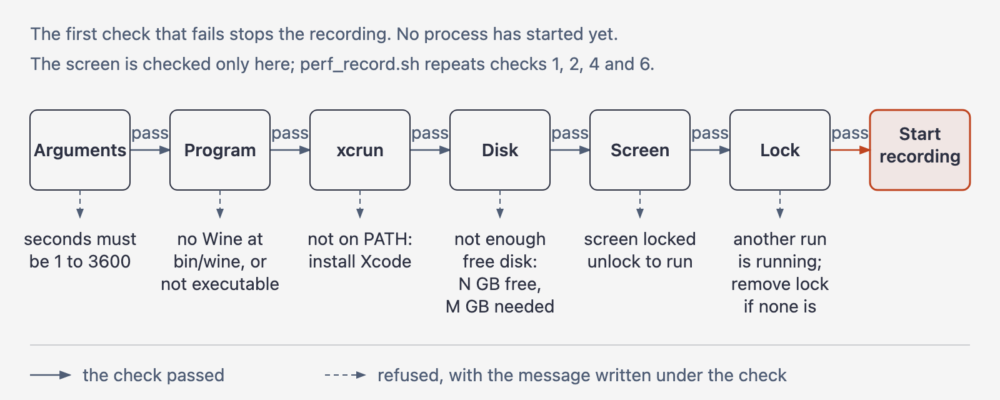

# Preflight

**Reader:** people who add or change a refusal in `preflight.py` or in `perf_record.sh`. Reviewed 2026-11-22. Labels: see [Recording](./index.md#how-to-read-the-labels).

**In short:** before anything starts, the server checks in milliseconds that the recording can work: valid numbers, the
program and Wine exist, `xctrace` is installed, there is enough disk, the screen is unlocked and nobody else is
recording. The first failure stops the call with a sentence that says what to do; nothing was started, so there is
nothing to clean up. Example: `seconds=5000` ends at once with `seconds is a whole number from 1 to 3600`.

`preflight.environment_report()` returns every check as an entry (`ok`, `missing` or `unknown`, whether it is fatal and
the exact fix, with no path or machine name); `preflight.check` runs it in a fixed order and raises a `ToolError` at the
first fatal entry ([E1](./evidence.md)). Two checks start a process: `xcrun --find xctrace` (`xctrace_problem`, timeout
20 s, run with the caller's environment so `DEVELOPER_DIR` is obeyed) and reading the screen state (`ioreg`, timeout
10 s, `perf_report.py:593-604`). On Windows the report looks for PresentMon on the disk and `PATH` and asks whether the
process is elevated; neither entry is fatal, because the engine still records.

*Figure 1. The checks of `preflight.check` and the message each one gives. HTML source: `img/preflight-checks.html`.*

| # | What it checks | Message when it fails | Code | Test (not run here) |
|---|---|---|---|---|
| 1 | `seconds` is a whole number from 1 to 3600 (`whole_seconds` refuses `10.5`, `True` and `"1_0"`, forms Python accepts and the shell would not) | `seconds is a whole number from 1 to 3600` | `check`, `whole_seconds` | `test_seconds_are_checked_before_anything_else` |
| 1 | `environ` is a mapping of text; `wine` is a path or `native` or `attach`; `command` is a list of strings | `environ is a mapping of text`, `wine is a path or native or attach, and the command a list of strings` | `check` | |
| 2 | A Wine directory holds an executable `bin/wine` | `no Wine at bin/wine inside that Wine directory (pass native for a macOS program)` | `wine_problem` | `test_missing_wine_binary` |
| 2 | With `native`: the program is a file with the execute bit | `<name> is not an executable file` (the file name only) | `check` | `test_native_program_not_executable` |
| 3 | `xcrun --find xctrace` finds `xctrace` with the request's environment (its `DEVELOPER_DIR` included; not on Windows) | xctrace is missing: install Xcode from the App Store, open it once and point xcode-select at it (`sudo xcode-select --switch /Applications/Xcode.app`; the Command Line Tools alone do not bring xctrace); `xcrun xctrace version` should then print a version | `xctrace_problem` | `test_no_xcrun`, `test_missing_xctrace_says_to_install_xcode_not_the_command_line_tools` |
| 4 | Free GB in the temporary folder and in the runs folder, each at least the need | `not enough free disk on the temporary folder (TMPDIR): N GB free, M GB needed (PERF_MIN_FREE_GB overrides)` (or `the runs folder`) | `disk_needed`, `environment_report` | `test_not_enough_disk_names_the_override` |
| 4 | The free space can be read (a path with a null byte, a failing `disk_usage`) | `the free disk space cannot be read for the runs or the temporary folder` | `free_gb` | `test_unreadable_disk_is_an_entry_of_the_environment_report` |
| 5 | The login session's screen is not locked (`ioreg`); not on Windows; `METAL_TRACE_ALLOW_LOCKED=1` skips it; an unreadable state passes | `the screen is locked: a locked session leaves the program's frames unpaced by the display, so the numbers do not compare; unlock the Mac, or set METAL_TRACE_ALLOW_LOCKED=1 to record anyway` | `environment_report` | `test_locked_screen_refuses_and_names_the_override` |
| 6 | The lock folder does not name a live process | `another recording is running; one runs at a time. If none is, remove the lock folder (METAL_TRACE_LOCK names it)` | `lock_owner_alive` | `test_live_lock_refuses` |

On Windows the report adds two entries beside these: `presentmon` names a missing PresentMon (with `presentmon_install`)
and `permissions` says `not elevated: PresentMon needs administrator rights or membership of the Performance Log
Users group`. Neither is fatal: without PresentMon the engine falls back to DWM frame times, and the report says what
to install instead of refusing a recording that would still run.

## How the numbers in check 4 come out

- The need is `PERF_MIN_FREE_GB` when it is a plain number, else `2 + (seconds × 8 + 9) / 10` in integer division
  (`disk_needed`): 18 GB for 20 s, 26 for 30 s, 50 for 60 s ([E3](./evidence.md)). Under Windows it is 1 GB, no
  Instruments. The shell script computes the same formula (`perf_record.sh:34`);
  `test_disk_formula_matches_the_shell` pins that they agree.
- The temporary folder is `TMPDIR` of the request's environment, or `/tmp`: where `xctrace` writes its `.ktrace` files.
- A runs folder that does not exist yet is measured at its nearest existing parent (`free_gb`).

## The lock check

`lock_owner_alive` is built for a folder anyone can write to: a hostile or broken `pid` file must not hang a
recording, signal a whole process group or crash the check.

| It does | Against |
|---|---|
| Refuses to follow a link | (no separate reason stated) |
| Reads at most 32 bytes with a non-blocking open | a hang (a pipe) |
| Accepts only ASCII digits up to 10 characters and a pid from 1 to 2³¹−1 | signalling a whole process group (pid 0 or −1) |
| Treats anything odd as "no live owner" | a crash of the check |

On Windows `os.kill` is never used (it ends the process); `process_alive` asks
`perf_record_windows.is_process_alive` (which asks `OpenProcess`). `test_hostile_pid_files_are_not_a_live_owner` pins
the odd cases.

## What preflight does not check

| Not checked | Who catches it, and how | Line |
|---|---|---|
| That a process to attach to exists (`perf_attach` passes preflight with any text) | The script: `no running process matches <name>` (exit 2). The Windows engine: the same as a `RuntimeError`. It arrives as `recording failed ...` or as a plain `ToolError` | `perf_record.sh:24`; `perf_record_windows.py:475`, `:480` |
| The Wine prefix, the working directory, the `api` against the platform | Used later, by the script or by `Popen` | |
| That the program is a Mach-O | The script compares the first four bytes against Mach-O magic numbers (and ELF and `#!`, "for the Linux CI") and refuses with `<name> is not a program the system can run (no Mach-O or #! header)` | `perf_record.sh:14-19` |

## What each layer repeats

| Check | `recording.py` / `preflight.py` | `perf_record.sh` |
|---|---|---|
| Label (`record` checks it before preflight) | `recording.py:312` | `:10` (exit 2) |
| Seconds 1 to 3600 | `check` | `:11` (exit 2) |
| Wine directory | `wine_problem` | `:12` (exit 2) |
| Native program | `check` | `:13`, `:14-19` (exit 2) |
| `xctrace` | `xctrace_problem` (`xcrun --find xctrace`) | none: `xcrun` is simply called |
| Disk | `environment_report` | `:34-38` (exit 4, the message carries the folder) |
| Screen locked | `environment_report` | none |
| Lock | `lock_owner_alive` | `:47-61` (exit 3) |
| Process to attach to | none | `:20-25` (exit 2) |

The script's exit codes and messages are in [E2](./evidence.md).
