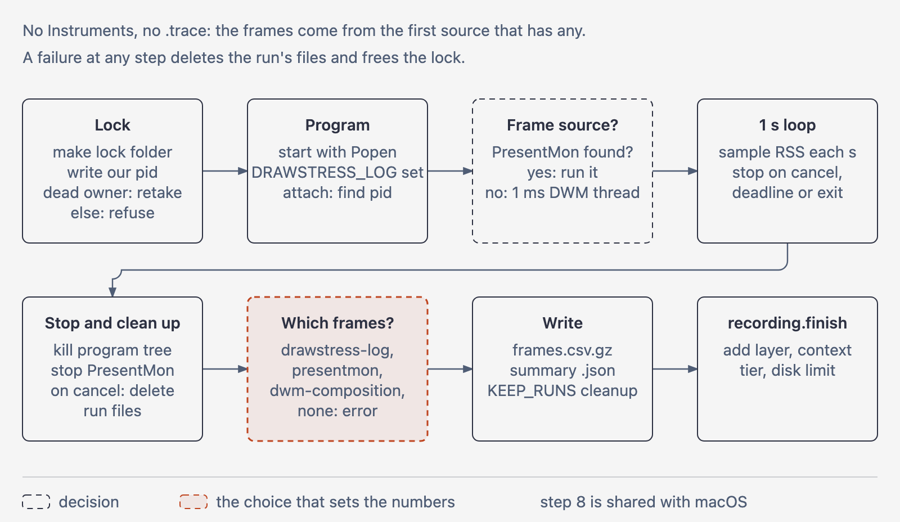

# The Windows engine

**Reader:** people who change `perf_record_windows.py` or who need to know why a Windows recording has no GPU timing per encoder. Reviewed 2026-11-16. Labels: see [Recording](./index.md#how-to-read-the-labels).

Español: [El motor de Windows](../../es/guides/grabar/motor-windows.md)

**In short:** Windows has no Instruments, so a separate engine records a Windows program by measuring when each frame
was shown on screen. It picks the best of three sources of frame data and writes the same kind of summary macOS does, with
some blocks empty. Example: for a game with PresentMon installed, the engine starts the game and PresentMon, waits the
requested seconds, and turns PresentMon's rows into the summary.

`perf_record_windows.py` is the whole of a Windows recording. The server calls it from `record_run` when
`sys.platform == "win32"` (`recording.py:373-385`), through a late import because the module may have been imported
already by something else (`:374`), and `record_run` then ends in the same `finish` as macOS (`:385`). It can also run by
hand: `python src\metal_gpu_trace\perf_record_windows.py <label> <seconds> <wine|native|attach> <prefix> <workdir> <command...>`
(`main`, `:950-962`; running it on the Mac without arguments prints the usage line, which was **not reproduced** here).

*Figure 1. One Windows recording. HTML source: `img/windows-engine.html`.*

## Why a separate engine, and what it measures

Instruments exists only on macOS, so the Windows engine cannot produce a `.trace`: there is no `xctrace`, no Metal
System Trace, no per-encoder timing. What it can measure is **when frames were presented**. It builds the same summary
shape through `metrics.py` (`:24-28`, `:887-917`), but several blocks are empty or fixed: `missing_tables` lists three
Metal tables by name, `metal_memory_mib` is `{"samples": 0}`, and `encoders` and `gpu_idle` are computed from the spans of
the one source that has any ([E8](./evidence.md)). The summary's keys are in the
[data guide](../data-and-lifecycle/json-keys.md#a-windows-summary).

## The three sources of frames, and which one wins

| Order | Source | `gpu.source` | What it gives | What it cannot give |
|---|---|---|---|---|
| 1 | The program's own log: `DRAWSTRESS_LOG`, one line per batch of frames (`dim`, `draws`, `frame_us`, `frames`) | `drawstress-log` | GPU time per frame (a mean per line) and spans for the encoder statistics | A frame-level distribution: 1% low, 0.1% low, stutter rate and jitter are `null` (`:859-862`), because each line is already a mean |
| 2 | PresentMon rows: `MsBetweenPresents` and, when the column exists and is positive, `MsGPUTime` | `presentmon` | One row per `Present()` of that process, with its GPU time | Per-encoder timing |
| 3 | A 1 ms thread reading the compositor (`DwmGetCompositionTimingInfo`) | `dwm-composition` | Intervals between composed frames of the **whole desktop** | GPU time per frame, and anything specific to the process |
| none | | | | The run fails: `no frame data` |

The order is the order of the `if` chain (`:787`, `:808`, `:819`, `:830`), so a **drawstress run on a machine that has
PresentMon installed still runs PresentMon** (it starts at `:652-659`, before the program's log is read) **but its rows
are not used**: the log wins. This is confirmed by the code; it was not reproduced.

Why three sources: the log is exact for the project's own test program, PresentMon is the right tool for any other
program, and the compositor is a last resort that works with no installed tool. The compositor sampler only counts an
interval between two consecutive composed frames: a jump of several frames is dropped rather than split into equal
parts (`:403-407`), so it never invents frames.

## Step by step (Figure 1)

| # | Stage | What happens | Line |
|---|---|---|---|
| 1 | **Lock** | The server passes `config.LOCK`, the same folder macOS uses; run by hand, the engine falls back to `<runs>/.recording` (`:574`). `mkdir`, write the pid; if it exists and its owner is dead, remove it and try once more (two attempts), otherwise `another recording is running (<lock>); remove it if none is` ([E9](./evidence.md)) | `:573-597` |
| 2 | **Program** | With `attach`, `find_attached_process` finds the pid by number or by a name inside the process name (the highest pid wins, `:457-483`). Otherwise it merges `program_env` and `PERF_ENV` into the environment, sets `DRAWSTRESS_LOG` to `<runs>/<name>.drawstress.log` and starts the program with `Popen` | `:612-645` |
| 3 | **Frame source** | If `find_presentmon` found one, start it with `--process_id`, `--timed <seconds>`, `--terminate_after_timed`, `--stop_existing_session`; otherwise start the DWM thread | `:647-666` |
| 4 | **The loop** | Once per second: sample the working set (`rss.csv`), look at the deadline and the cancel flag, and stop early if the program exited by itself. Progress goes out every 5 s | `:673-705` |
| 5 | **Stop** | Stop the DWM thread; wait up to 15 s for PresentMon, killing it if it does not stop; on cancel or overrun, kill the program tree, delete every file starting with the run's name and raise `the recording was cancelled; nothing was saved` or `the recording took over N s and was stopped; nothing was saved` (`:744-746`). If the recording completed and the program is still alive, terminate it, then kill its tree | `:707-757` |
| 6 | **Which frames** | The table above | `:759-844` |
| 7 | **Write** | The `frames.csv.gz` table, the statistics (the pacing numbers come from `perf_report.frame_pacing`, the same function macOS uses, `:489`), the summary, the `common` block, the `.json`, and `KEEP_RUNS` through its own `clean_runs` (`:503-518`, `:921-924`) | `:846-927` |
| 8 | **Finish** | Back in `record_run`, `finish` adds `layer`, `context`, `tier` and the disk limit | `recording.py:385` |

A `finally` runs whenever the recording did not succeed: it stops the DWM thread and PresentMon, kills the program it
started (never an attached one) and deletes every file starting with the run's name, then frees the lock
(`:929-947`). The lock is released on success too.

## What differs from macOS

| | macOS | Windows |
|---|---|---|
| Recorder | `perf_record.sh` driving `xctrace` | `perf_record_windows.py`, in the server's own process |
| Tiers | `light`, `standard`, `deep` | `deep` refused (`recording.py:49-50`); `memory` has no effect: there is no Metal memory table |
| `memory_free_pct`, `background` | allowed | refused (`recording.py:283-284`) |
| Disk needed | `2 + 0.8 GB` per second, in `TMPDIR` and the runs folder | 1 GB, in the runs folder (`preflight.py:50`, `:123-124`) |
| `xcrun`, screen | checked | not checked (`preflight.py:120`, `:132`) |
| Program's stop at the end | by name (`native`) or `wineserver -k` | the process tree (`kill_process_tree`, `:521-551`) |
| Wine | yes | no: `wine` becomes `native` when none is given (`recording.py:61-65`), and an api marked `wine: true` runs natively (`workloads.py:88-89`) |
| Lock life | `mkdir` + takeover under a second lock | `mkdir` + one stale takeover, with no second lock ([limit 3](./limits.md)) |
| Frame table | `frames.csv.gz` with one `gpu_ms_<channel>` per channel | `frames.csv.gz` with `gpu_ms_draw` and `gpu_ms_total` (`:847`) |

## Hardware facts for the `device` block

`perf_record_windows.py` also reads hardware facts for the `device` block: Win32 for the processor, RAM and OS version,
and when a `vegaflow_daemon.exe` is found next to the clone, a `--system-info` call with a 1 s timeout that adds CPU and
GPU architecture names (`collect_device_info`, `:242-283`; `daemon_candidates` `:231-239`). Any failure falls back to
the Win32 facts silently. What VegaFlow is, where it comes from and who runs it is **not documented in this repository's
guides** and was not investigated: pending confirmation ([limit 14](./limits.md)).
