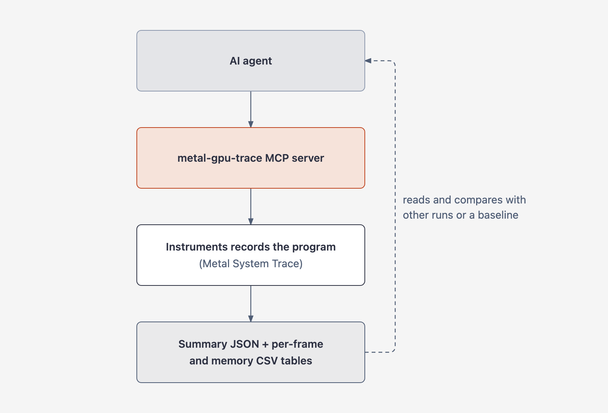

# metal-gpu-trace

[](https://github.com/partprogramming09/metal-gpu-trace/actions/workflows/test.yml)

<!-- mcp-name: io.github.partprogramming09/metal-gpu-trace -->

[English](../README.md) · Español

## En palabras sencillas

metal-gpu-trace mide cuánto trabaja el chip gráfico (la GPU) de un Mac con Apple silicon al ejecutar un programa, y si sus imágenes salen parejas. Sirve a quien porta o prueba juegos y apps en Mac, incluidos los juegos de Windows que corren con Wine, y a los agentes de programación con IA que los ayudan.

Ejemplo real: una grabación de 20 segundos del programa de prueba `drawstress` corrió a 104,5 FPS, y la GPU necesitó 5,6 ms para dibujar cada imagen (ver [Un primer resultado](#un-primer-resultado)).

Pide a tu agente que grabe de nuevo tras un cambio, y te dice con cifras si el programa salió más rápido, más lento o igual. Para grabar necesita Xcode, y no arregla el programa.

## Cómo funciona

Tu agente de IA llama al servidor metal-gpu-trace. El servidor arranca Instruments (el analizador de Apple, que viene con Xcode), que graba el programa los segundos que pediste. Escribe un resumen (un archivo JSON con las cifras) y dos tablas pequeñas, una fila por frame y otra para la memoria. El agente las lee y las compara con otras grabaciones o con una referencia guardada.



Detalles para quien cambia el código: [Cómo funciona](../docs/guides/how-it-works.md).

## Empezar en 4 pasos

1. **Instala Xcode** desde la App Store. Abre la app Terminal y escribe `xcrun xctrace version`: debe imprimir una versión.
2. **Instala uv**, una herramienta que descarga y ejecuta el servidor por ti. En Terminal: `brew install uv` (necesita Homebrew, ver brew.sh).
3. **Conecta el servidor a tu agente.** Un servidor MCP es un programa auxiliar pequeño que le da herramientas nuevas a tu agente de IA. Ejecuta `uvx metal-gpu-trace init` para configurar de una vez todas las apps de IA que encuentre, o, para Claude Code, pega esto en Terminal (`METAL_TRACE_OUT` es la carpeta donde se guardan las grabaciones): `claude mcp add --scope user metal-trace -e METAL_TRACE_OUT=$HOME/perf-runs -- uvx metal-gpu-trace`. Para otras apps de IA, mira [Servidor MCP](#servidor-mcp).
4. **Pregunta:** «Graba mi app 30 segundos y dime sus FPS y cuánto tarda la GPU por frame.» Para un programa de Windows bajo Wine (software que ejecuta programas de Windows en un Mac), añade también `-e METAL_TRACE_WINE=/ruta/a/wine` al comando del paso 3 (ver [Instalar](#instalar)).

## Palabras que se usan

- **frame**: una imagen que dibuja el programa. Un juego a 60 FPS dibuja 60 cada segundo.
- **FPS**: frames por segundo. Más es más fluido, hasta que la frecuencia de la pantalla lo limita (vsync).
- **GPU ms por frame**: los milisegundos que trabaja el chip gráfico en un frame. Menos es mejor, y a diferencia de los FPS la pantalla no lo limita.
- **1 % low** (en el resto del texto, «1 % bajo»): los FPS del 1 % de frames más lentos. Muestra el entrecorte que esconde un promedio, y necesita al menos 100 frames.
- **hitch**: un frame que tarda mucho más que sus vecinos; se ve como un tirón.
- **frame pacing**: qué tan parejos llegan los frames. Intervalos parejos se ven fluidos; irregulares se ven como entrecortes.
- **encoder**: un bloque de órdenes que el programa manda a la GPU. Demasiados diminutos desperdician tiempo de GPU.
- **command buffer**: el paquete de trabajo que un programa entrega a la GPU; contiene uno o más encoders.
- **translation layer**: software que deja correr en Metal un programa escrito para otra API gráfica (Direct3D, Vulkan), como DXMT, Mullion o MoltenVK.
- **Wine**: software que ejecuta programas de Windows en un Mac.
- **Metal System Trace**: la plantilla de grabación de Instruments que registra lo que hace la GPU; esta herramienta graba con ella.
- **.trace**: el archivo que escribe Instruments. Es grande (decenas o cientos de MB), así que se borra tras el resumen salvo que pongas `KEEP_TRACE=1`.
- **.gputrace**: una captura de Metal de las órdenes de dibujo de unos pocos frames; esta herramienta la lee sin Xcode.
- **baseline**: una referencia guardada, hecha de varias grabaciones iguales. Muestra cuánto se mueve una cifra sola, para juzgar contra ella una corrida posterior.
- **regression**: un cambio que deja el programa peor que su baseline, por ejemplo unos FPS por debajo del rango de la referencia por más del margen.

## Un primer resultado

Un resumen recortado de una grabación real de 20 segundos del programa de prueba `drawstress` en Metal nativo (el archivo tiene muchos más campos):

```json
{
  "process": {"name": "drawstress", "arguments": "--mtl"},
  "duration_s": 20.78,
  "gpu": {
    "frames": 2034,
    "fps_estimate": 104.5,
    "frame_gpu_ms": {"mean": 5.564, "p95": 6.16},
    "frame_interval_ms": {"p95": 10.017, "max": 22.189}
  },
  "encoders": {"per_frame": {"p50": 2}},
  "gpu_idle": {"idle_share": 0.422}
}
```

Se lee así: 2 034 frames en 20,8 s. `fps_estimate` vale 104,5: sale de la mediana del intervalo entre frames, así que puede diferir de frames divididos entre segundos (unos 98). La GPU necesitó 5,6 ms por frame de media, y menos de 6,2 ms en el 95 % de ellos (`p95`). La espera más larga entre dos frames fue de 22,2 ms. El programa mandó 2 encoders por frame (la mediana, `p50`) y la GPU estuvo ociosa el 42 % del tiempo. Una grabación sola dice poco: compara dos, y repite una corrida antes de dar una diferencia por real.

## Novedades

Versión 0.28.0. Cada punto enlaza al comando que se ejecutó y a su salida real.

- ✨ **Respuestas más cortas: `fields`.** Toda herramienta acepta un `fields` opcional, una lista de rutas con puntos que recorta el resultado antes de enviarlo (`perf_runs` con `fields=["fps"]` devuelve solo los fps de cada corrida); una ruta que no coincide con nada se nombra en `_meta.fields_missing`. `tools/list` también es más corto: 33 072 caracteres en vez de 45 186. [Prueba](../docs/evidence/v0.28.0.md#every-tool-takes-fields-and-the-tool-list-is-shorter)
- ✨ **Un comando para configurar el servidor.** `metal-gpu-trace init` agrega el servidor a Claude Code, Claude Desktop, Cursor y Codex CLI con rutas absolutas; `--dry-run` muestra el cambio antes, y una config existente se fusiona (los otros servidores se conservan) con una copia `.bak`. [Prueba](../docs/evidence/v0.28.0.md#metal-gpu-trace-init-sets-the-server-up-in-one-command)
- ✨ **Las tablas sobreviven al `.trace`.** Cada grabación guarda sus tablas en `<run>.tables.sqlite`, y `trace_query` gana `where`, `columns`, `order_by`, `group_by` y `aggregates`: las mismas filas que el `.trace` en 0,02 s en vez de 3,8 s, y un conteo por canal en una sola llamada. Probado en una grabación real de Metal, no en Windows. [Prueba](../docs/evidence/v0.28.0.md#the-tables-are-kept-in-a-sqlite-file-and-queried-with-filters)

Versión 0.27.3, aún vigente:

- ✨ **Una sola forma de resumen en las dos plataformas.** Todo resumen nuevo (`schema_version` 3) trae un bloque `common` con el ritmo de frames, la presión de memoria y la API gráfica, con las mismas claves en macOS y Windows y un `source` por número; lo que no se puede medir igual dice `comparable: false` en vez de un número inventado. [Prueba](../docs/evidence/v0.27.3.md#a-summary-has-a-common-block-on-both-platforms)
- 🔍 **Qué reservó una grabación.** `perf_memory_breakdown` reparte las reservas de Metal por tipo, lo que sigue vivo y cuántas veces se reservó la memoria viva (5,47 en una corrida real), solo con el resumen. [Prueba](../docs/evidence/v0.27.3.md#what-a-recording-allocated-by-type)
- 🩺 **Un veredicto honesto contra una sola corrida.** `perf_check` añade una `note` cuando el veredicto no es same y la referencia es una sola corrida: su ruido no está medido, así que un cambio pequeño puede ser ruido. [Prueba](../docs/evidence/v0.27.3.md#perf_check-says-when-its-reference-is-one-run)

Las versiones anteriores (0.27.2, 0.27.0 y las más viejas) están en el [changelog](../CHANGELOG.md), cada una con su prueba en [docs/evidence/](../docs/evidence/). Un cambio que conviene saber: una pantalla bloqueada ahora rechaza la grabación (`METAL_TRACE_ALLOW_LOCKED=1` graba igual).

## Para quien desarrolla

Mide cómo usa la GPU un programa de Wine o de macOS en un Mac con Apple silicon, desde la línea de comandos o a través de un agente de programación con IA: tiempo de GPU por frame, ritmo de frames, FPS y memoria; si una capa de traducción (DXMT, Mullion, MoltenVK) reparte el trabajo en demasiados encoders cortos; capturas `.gputrace` de Metal leídas sin Xcode; y los datos que publica Apple de cada familia de GPU. Biblioteca estándar de Python 3.9+, `zsh` y Xcode (para `xctrace`). Licencia MIT ([LICENSE](../LICENSE)). [English](../README.md).

Arquitectura, decisiones y guías: [`docs/README.md`](../docs/README.md). Para enviar un cambio: [`CONTRIBUTING.md`](../CONTRIBUTING.md).

| Archivo | Qué hace |
| --- | --- |
| `src/metal_gpu_trace/perf_record.sh` | Graba un programa N segundos y escribe `<etiqueta>_<fecha>.json` más los CSV por frame y de memoria. Borra el `.trace` salvo con `KEEP_TRACE=1`. |
| `src/metal_gpu_trace/perf_report.py` | Resume igual un `.trace` ya grabado. |
| `src/metal_gpu_trace/gputrace_read.py` | Lee una captura `.gputrace` de Metal sin Xcode. Los nombres de llamada marcados `probable` no están confirmados. |
| `src/metal_gpu_trace/data/apple-gpu-families.json` | Apple7 a Apple10: chips, qué añade cada familia y los límites que cambian, con las fuentes de Apple. |
| `src/metal_gpu_trace/metal_trace_mcp.py` | El servidor MCP sobre todo lo anterior. |
| `tests/` | Comprobación sin Instruments: `python3 -I tests/run.py` imprime `ok`; `pytest tests` corre las mismas pruebas. |

## Grabar

```sh
PERF_OUT=~/perf-runs zsh src/metal_gpu_trace/perf_record.sh game-d3d12 30 /path/to/wine ~/.wine /path/to/game game.exe
PERF_OUT=~/perf-runs zsh src/metal_gpu_trace/perf_record.sh app-metal 30 native - /path/to/app ./app
```

Argumentos: etiqueta, segundos, un directorio de Wine con `bin/wine` (o `native`), el prefijo de Wine, el directorio de trabajo, el programa y sus argumentos. Sin `PERF_OUT`, las grabaciones van a `./perf-runs`. Leer la traza tarda cerca de un minuto en un M1 Pro (87 s para una grabación de 10 s). Con el servidor MCP, la llamada se corta tras 10 s por segundo grabado más 120 s, y una grabación cortada no deja archivos. Solo corre una grabación a la vez; no uses la GPU para otra cosa mientras graba. Con Wine, graba 30 s: el arranque de Wine ocupa parte de la grabación. Menos de 100 frames es demasiado poco para comparar.

## Espacio en disco

Cada grabación guarda un resumen JSON y tres CSV, unos 2 MB por 10 s (casi todo, las muestras de memoria de Metal). El `.trace` se borra salvo con `KEEP_TRACE=1`. `PERF_MEMORY=0` se salta la tabla de memoria de Metal, la más lenta de leer (un 41 % más rápido al resumir una traza de 626 MB); el resumen entonces no trae `metal_memory_mib`. Las herramientas MCP `perf_record` y `perf_baseline_record` ofrecen lo mismo como `memory=false`. Qué borra cada ajuste: [Retención](../docs/guides/data-and-lifecycle/retention.md).

## Servidor MCP

### Instalar

El servidor corre con [`uvx`](https://docs.astral.sh/uv/) desde [PyPI](https://pypi.org/project/metal-gpu-trace/), sin clonar nada (`brew install uv` lo instala). Para grabar hace falta además Xcode (`xcrun xctrace version` imprime una versión).

```sh
uvx metal-gpu-trace
```

Es el comando que lanza cada cliente de abajo. Las apps de escritorio no ven el `PATH` de Homebrew: dales la ruta completa que imprime `which uvx` (`/opt/homebrew/bin/uvx` en Apple silicon). `uvx` se queda con la versión que bajó la primera vez; para tener la última, corre una vez el comando con `--refresh`. `uvx metal-gpu-trace@0.4.0` fija una versión.

El servidor lee estas variables de entorno:

| Variable | Qué fija |
| --- | --- |
| `METAL_TRACE_OUT` | Dónde van las grabaciones. Da una ruta absoluta: la de serie, `./perf-runs`, depende de la carpeta de trabajo del cliente. Un archivo de proyecto (abajo) manda sobre ella. |
| `METAL_TRACE_PROJECT` | El archivo de proyecto que se usa (o la carpeta que lo tiene), en vez de buscarlo desde el directorio de trabajo. |
| `METAL_TRACE_WINE` | El directorio de Wine (con `bin/wine`) que usa `perf_record` si la llamada no indica otro. |
| `WINEPREFIX` | El prefijo de Wine si la llamada no indica otro; si no, `~/.wine`. |
| `METAL_TRACE_READ` | Más directorios que las herramientas pueden leer, separados por `:` (`;` en Windows). |
| `METAL_TRACE_LOG` | `off` apaga la línea de log por llamada en stderr. |
| `KEEP_TRACE` | `1` guarda el `.trace` de cada grabación, para Instruments o el export en bruto (el archivo de tablas ya responde `trace_tables`, `trace_count` y `trace_query`). |
| `PERF_TABLES` | `0` no escribe `<etiqueta>.tables.sqlite`. |
| `METAL_TRACE_ALLOW_LOCKED` | `1` graba con la pantalla bloqueada. Sin él la grabación se rechaza: una sesión bloqueada deja los frames sin ritmo. |
| `METAL_TRACE_MAX_DISK_MB` | Límite de tamaño de la carpeta de grabaciones, en MiB. Tras cada grabación se borran primero el `.trace` más viejo, luego el `.chrome-trace` y luego las tablas por frame y de memoria; nunca los resúmenes ni `baselines.json`. [Retención](../docs/guides/data-and-lifecycle/retention.md) |
| `KEEP_RUNS` | Guarda solo las N grabaciones más recientes. Nunca quita un `.trace`, y `baselines.json` nunca se borra. [Retención](../docs/guides/data-and-lifecycle/retention.md) |
| `METAL_TRACE_LOCK` | El candado que hace que las grabaciones vayan de una en una, vaya cada una a la carpeta que vaya (de serie, `~/Library/Caches/metal-gpu-trace/recording.lock`). [Caché y candado](../docs/guides/data-and-lifecycle/cache-and-lock.md) |
| `PERF_ENV` | Pares `NOMBRE=VALOR`, separados por espacios, que recibe el programa grabado. |
| `PERF_INSTRUMENTS` | Instrumentos que se añaden a la plantilla Metal System Trace, separados por `;` (`xcrun xctrace list instruments` los nombra). Sus tablas necesitan el `.trace`: va con `KEEP_TRACE=1`. |

### Proyectos

Un repositorio puede tener un `metal-gpu-trace.json` que da nombre a su proyecto y a la carpeta de sus grabaciones:

```json
{"name": "my-game", "runs": "perf-runs", "baseline": "main-ref"}
```

El servidor lo busca en su directorio de trabajo y en las carpetas de encima, hasta debajo de la carpeta personal, así que un solo archivo en la raíz del repositorio sirve para todas sus carpetas. Si lo encuentra, las grabaciones van a `runs` y se leen de allí en vez de `METAL_TRACE_OUT`, y `baselines.json` vive allí también: los proyectos no mezclan sus grabaciones. [Archivo de proyecto](../docs/guides/data-and-lifecycle/project-and-config.md)

| Clave | Significado |
| --- | --- |
| `name` | El nombre del proyecto (letras, dígitos, `.`, `_`, `-`). Obligatorio. |
| `runs` | La carpeta de las grabaciones. Obligatoria. Tiene que ser nueva, estar vacía o tener ya la marca del servidor (un archivo `.metal-gpu-trace-runs` normal, no una carpeta ni un enlace). Una carpeta con otros archivos se rechaza, porque `KEEP_RUNS` borra allí los `.json` viejos. Una carpeta marcada con el nombre de otro proyecto se rechaza; para pasarla, edita o borra su marca. |
| `baseline` | El nombre de la referencia del proyecto (`perf_baseline`). `project_info` la informa. |
| `format` | `metal-gpu-trace`, el único por ahora. |

Cualquier otra clave, o un valor equivocado, es un error que cada herramienta explica, con el campo, hasta que se arregle el archivo. Sin archivo de proyecto se usa `METAL_TRACE_OUT`, o `./perf-runs`, como antes.

### Un solo comando: `init`

`uvx metal-gpu-trace init` busca las apps de IA instaladas en este Mac (Claude Code, Claude Desktop, Cursor, Codex CLI) y
añade el servidor a cada una, con la ruta absoluta de `uvx` y `METAL_TRACE_OUT` en `~/perf-runs`, ya resuelta.

```sh
uvx metal-gpu-trace init --dry-run                       # muestra lo que escribiría, sin escribir
uvx metal-gpu-trace init --client cursor --wine /ruta/a/wine
```

Opciones: `--client claude-code|claude-desktop|cursor|codex|vscode`, `--wine DIR` (un directorio de Wine con
`bin/wine`; si está, se usa `METAL_TRACE_WINE`), `--out DIR`, `--dry-run`, `--project`. Un JSON existente se fusiona
(tus otros servidores se quedan) y antes se copia a `<archivo>.bak`; un archivo que no es JSON válido se rechaza sin
tocarlo. En Codex el bloque se añade al final de `config.toml` si falta, y solo se muestra si ya existe
`[mcp_servers.metal-trace]`. Claude Code se registra con `claude mcp add`, sin editar su archivo. VS Code pide
`--project` (escribe `.vscode/mcp.json`); los archivos de `--project` llevan rutas absolutas de tu máquina: no los
versiones. En otros sistemas las rutas de las apps no están verificadas y `init` dice «no soportado todavía».
Reinicia la app después.

### Claude Code

```sh
claude mcp add --scope user metal-trace -e METAL_TRACE_OUT=$HOME/perf-runs -e METAL_TRACE_WINE=/path/to/wine \
  -- uvx metal-gpu-trace
claude mcp list
```

`claude mcp list` muestra `metal-trace` como conectado. `--scope user` lo deja disponible en todos los proyectos; si lo quitas, queda solo en el proyecto actual.

### Windows

En Windows el servidor graba programas nativos (`src/metal_gpu_trace/perf_record_windows.py`): sin Wine ni Metal, y no hace falta `METAL_TRACE_WINE`. Los frames vienen de [PresentMon](https://github.com/GameTechDev/PresentMon) de Intel (MIT), que se instala con `presentmon_install`, se encuentra en el `PATH` o se apunta con `PRESENTMON_EXE`. Sin él, el resumen usa los intervalos de composición de DWM (`gpu.source` es `dwm-composition`), que cubren todo el escritorio y no traen tiempo de GPU. Sin ninguna de las dos fuentes una grabación falla; nunca inventa frames. Detalles: [Motor de Windows](../docs/guides/recording/windows-engine.md).

```powershell
winget install --id=astral-sh.uv -e
claude mcp add --scope user metal-trace -e METAL_TRACE_OUT=%USERPROFILE%\perf-runs -- uvx metal-gpu-trace
claude mcp list
```

En los clientes con JSON usa `"command": "uvx"` (o la ruta completa que imprime `where uvx`) y rutas de Windows con las barras invertidas dobles. Claude Desktop lee `%APPDATA%\Claude\claude_desktop_config.json`. Las pruebas de Windows se corren con `python -m pytest tests/test_perf_record_windows.py`.

### Claude Desktop, Cursor y otros clientes con JSON

Estas apps no expanden `~` ni `$HOME`: escribe rutas absolutas.

```json
{
  "mcpServers": {
    "metal-trace": {
      "command": "/opt/homebrew/bin/uvx",
      "args": ["metal-gpu-trace"],
      "env": {
        "METAL_TRACE_OUT": "/absolute/path/to/perf-runs",
        "METAL_TRACE_WINE": "/absolute/path/to/wine"
      }
    }
  }
}
```

| Cliente | Archivo |
| --- | --- |
| Claude Desktop | `~/Library/Application Support/Claude/claude_desktop_config.json` (Ajustes, Desarrollador, Editar configuración); reinicia la app |
| Cursor | `~/.cursor/mcp.json` |
| VS Code | `.vscode/mcp.json` en el proyecto; la clave de arriba es `servers` en vez de `mcpServers`, y el servidor añade `"type": "stdio"` |
| Codex CLI | `~/.codex/config.toml`: una tabla `[mcp_servers.metal-trace]` con los mismos `command`, `args` y `env` |

### Herramientas

26 herramientas en cuatro grupos. Tu agente las elige; rara vez llamas a una tú. Todas aceptan además `fields`, opcional: una lista de rutas con punto, como `common.frame_pacing.fps_1pct_low`; el resultado conserva solo esas (en una página, en cada fila), así el agente lee unos pocos números y no el resumen entero. Una ruta que no existe aparece en `_meta.fields_missing`. Los argumentos de cada una están en [Servidor y transporte](../docs/guides/server-and-transport/registry.md).

| Grupo | Herramientas (para qué sirve cada una) |
| --- | --- |
| Grabar | `perf_record` (una corrida y su resumen), `perf_attach` (un programa ya en marcha), `perf_baseline_record` (varias corridas guardadas como referencia), `perf_ab` (dos entornos, cuál es mejor), `perf_sweep` (una corrida por valor de un ajuste), `perf_cold_warm` (primer arranque frente al segundo, tirones por compilar shaders) |
| Juzgar y comparar | `perf_compare` (dos grabaciones, qué mejoró o empeoró), `perf_check` (igual, mejor o regresión frente a una referencia), `perf_gate` (pasa o falla según tus límites), `perf_baseline` (guarda corridas iguales y muestra su dispersión), `perf_history` (una cifra a lo largo de muchas corridas), `perf_diagnose` (demasiadas piezas diminutas de GPU, como causan las capas de traducción), `perf_memory_breakdown` (asignaciones de Metal por tipo) |
| Ir más a fondo | `perf_export_trace` (frames para Perfetto o Chrome), `trace_tables`, `trace_count`, `trace_query` (tablas de un `.trace` conservado), `capture_summary`, `capture_diff`, `capture_records` (capturas `.gputrace`) |
| Preparación y programas de prueba | `project_info` (proyecto activo), `perf_runs` (grabaciones, la más nueva primero), `gpu_family` (datos de Apple por familia o chip), `workload_list`, `workload_fetch` (programas de prueba, verificados por SHA-256; Claude Code pregunta antes), `presentmon_install` (solo Windows) |

Los programas de prueba, sus argumentos (`workload`, `api`, `dim`, `size`, `example`) y las palancas del Mac están en [Programas de prueba](../docs/guides/recording/test-programs.md). Cómo leer las cifras entre corridas: [Leer y comparar](../docs/guides/summarizing/reading-and-comparing.md).

## HTTP

`METAL_TRACE_TOKEN=<secreto de 16 caracteres o más> metal-gpu-trace --http [--port N]` sirve las mismas herramientas en `POST http://127.0.0.1:8765/mcp`, para un cliente del mismo Mac que no puede arrancar un servidor stdio. Escucha solo en 127.0.0.1, exige `Authorization: Bearer <token>` en cada petición y no arranca sin el token. Habla las dos épocas de MCP: [HTTP](../docs/guides/server-and-transport/http.md), y por qué dos: [ADR-0002](../docs/adr/0002-dual-era-mcp.md).

## Compuerta de CI

`metal-gpu-trace check CORRIDA REFERENCIA [--margin-pct N]` ejecuta `perf_check` sin cliente e imprime una línea JSON. Código de salida 0: igual o mejor; 1: empeoró; 2: no se pudo juzgar (no existe la corrida o la referencia, o tiene menos de 100 frames). Grabar necesita Instruments, así que el job corre en un runner de macOS propio:

```yaml
jobs:
  perf:
    runs-on: [self-hosted, macOS, ARM64]
    steps:
      - run: PERF_OUT=~/perf-runs zsh path/to/metal-gpu-trace/src/metal_gpu_trace/perf_record.sh pr 30 native - . ./app
      - run: METAL_TRACE_OUT=~/perf-runs metal-gpu-trace check "$(ls -t ~/perf-runs/pr_*.json | head -1 | xargs basename -s .json)" main-ref
```

## Si quieres entender...

- ...cómo está organizado el código y cómo llega una petición de principio a fin: [Cómo funciona](../docs/guides/how-it-works.md).
- ...cómo ejecutarlo o probarlo desde un clon, sin PyPI: [Ejecutar desde un clon](../docs/guides/run-from-a-clone.md).
- ...qué deja una grabación en disco y qué borra cada cosa: [Datos y su ciclo de vida](../docs/guides/data-and-lifecycle/index.md).
- ...por qué se rechaza una grabación o por qué falló: [Comprobación previa](../docs/guides/recording/preflight.md), [Fallos](../docs/guides/recording/failures.md).
- ...cómo se calculan los FPS, el 1 % bajo, el entrecorte y los tirones: [Cómo se calculan las cifras](../docs/guides/summarizing/how-numbers-are-computed.md).
- ...por qué dos corridas dicen igual, mejor o peor: [Ruido y veredictos](../docs/guides/summarizing/noise-and-verdicts.md).
- ...cómo se lee un `.trace` o un `.gputrace`: [Leer trazas](../docs/guides/reading-traces/index.md).
- ...HTTP, las dos épocas de MCP y el registro de herramientas: [Servidor y transporte](../docs/guides/server-and-transport/index.md).
- ...la ruta de grabación en Windows: [Motor de Windows](../docs/guides/recording/windows-engine.md).
- ...por qué se tomó cada decisión: [`docs/README.md`](../docs/README.md) (el índice de ADR).
- ...la prueba que respalda cada versión: [docs/evidence/](../docs/evidence/).

## Créditos

- La estructura de los registros de un `.gputrace` sigue [tmc/gputrace](https://github.com/tmc/gputrace) (MIT); no se copia código. Los identificadores de llamada se cotejaron con la lista de comandos de Xcode en macOS 27.0.1.
- Datos de las familias de GPU: los documentos de Apple enlazados arriba, dichos con otras palabras, sin citarlos.
